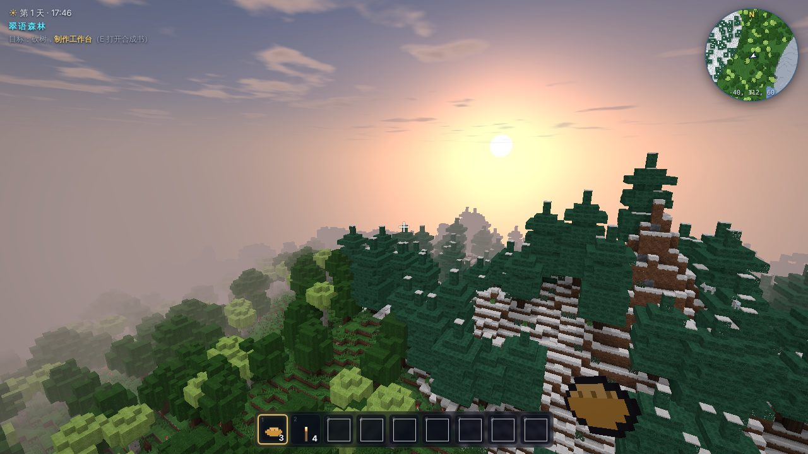
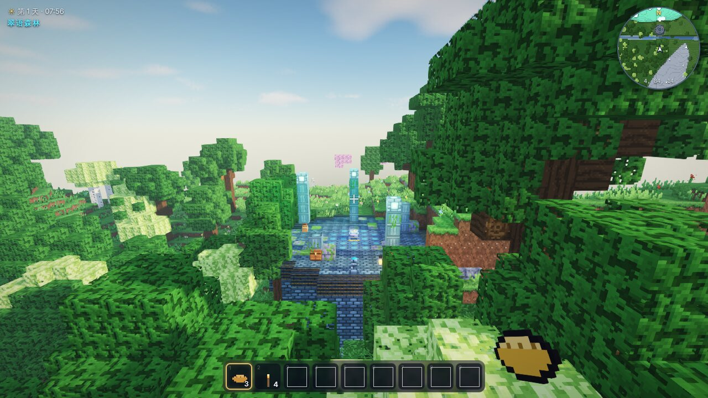
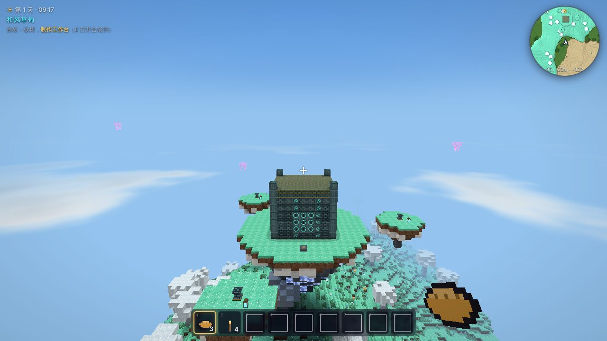
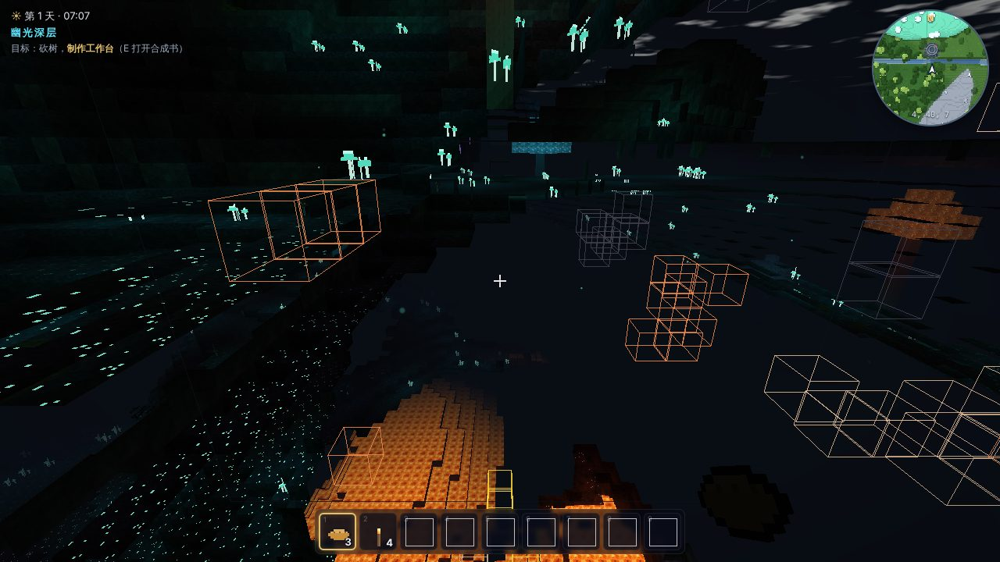
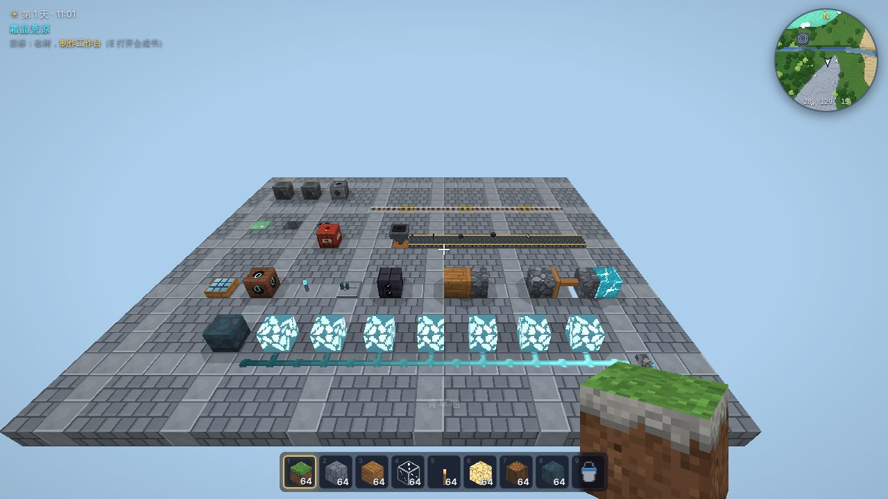
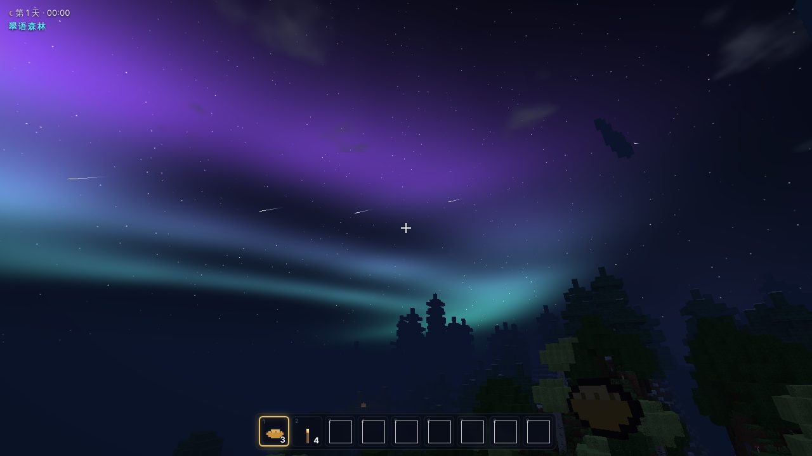

# 回响荒野 Echowild

一款原创的三维体素开放世界沙盒游戏，可以探索、建造、生存、冒险和创造，直接在浏览器里运行。

很久以前，**织者**用回响之丝编织出这个世界。后来，一场“大寂静”让天空碎裂，群岛浮上云端，五枚**回响碎片**散落四方。你在一座沉默的**织心祭坛**旁醒来。你可以砍树、挖矿、种田，搭一座房子；也可以用共鸣电路造出自动化机械；还可以带着回响罗盘，穿过沙海、冰原、深海、地底和云端，找回五枚碎片，让世界重新织起。



| | |
| --- | --- |
|  |  |
| 出生点旁的织心遗迹 | 浮空群岛上的天穹神殿 |
|  |  |
| 幽光深层里，回响脉冲穿透岩石显示矿脉 | 共鸣电路、推进器、传送带与轨道 |
|  | |
| 寒冷的夜晚会出现极光，偶尔有流星雨 | |

> 以上截图来自无头 Chromium（SwiftShader 软件渲染）的自动化截图，不是实机录屏。

[在线游玩](https://xhc144.github.io/claude-lab/echowild/) · [下载单文件版](https://xhc144.github.io/claude-lab/echowild/echowild.html) · [项目导航](../README.md)

## 开始游戏

**方式一：单文件版（推荐）。** 下载 [`dist/echowild.html`](dist/echowild.html)，双击用浏览器打开就能玩。它离线可用，不需要安装任何东西。需要支持 WebGL2 的桌面浏览器（新版 Chrome、Edge、Firefox 或 Safari）。

**方式二：从源码运行。**

```bash
cd echowild
npm start              # 打开 http://127.0.0.1:5173
```

源码版是零依赖的 ES 模块。因为浏览器不允许从 `file://` 加载模块和 Worker，所以要用自带的 `scripts/serve.mjs` 起一个静态服务器。

存档保存在浏览器的 IndexedDB 里，游戏每 30 秒自动保存一次，切到后台时也会保存。在“开始冒险”的世界列表里可以把世界**导出**成 JSON 文件，也可以再**导入**回来。如果浏览器不允许本地存储，世界列表会提示，这时存档只保留到关闭页面为止。

## 操作

| 按键 | 作用 | 按键 | 作用 |
| --- | --- | --- | --- |
| W A S D | 移动 | 空格 | 跳跃 / 上浮 / 空中按住展开滑翔翼 |
| 鼠标 | 环顾 | Shift | 潜行（不会从边缘掉落） |
| Ctrl / 双击 W | 疾跑 | 双击空格 | 飞行（创造模式 / 织星之翼） |
| 左键 | 挖掘 / 攻击 | 右键 | 放置 / 使用 / 交互 |
| 滚轮 / 1–9 | 切换快捷栏 | E | 背包与合成书 |
| F | 回响脉冲（需要回响罗盘） | M | 地图 |
| J | 探险图鉴 | T 或 / | 聊天与指令 |
| Q | 丢弃 | X | 与副手交换 |
| C | 望远 | V / F5 | 切换第一 / 第三人称 |
| F1 | 隐藏界面 | F3 | 调试信息 |

游戏内的“玩法指南”（标题页和暂停菜单里都有）介绍了生存入门、共鸣机械和碎片冒险。

## 已经实现的内容

以下都是游戏里真实可玩的内容，数字取自源码。

**世界**
- 由种子决定的无限世界，横向不设边界，高 256 格。**16 种生物群系**：和风草甸、翠语森林、霞樱林、萤火沼泽、流金沙海、赤岩峡谷、霜原、霜杉林、苍岩山脉、霜晶荒原、海洋、冰封之海、海滩、河流，还有高空的浮空群岛和地底的幽光深层。
- 地形包括山脉、河流和海洋。地下有面条状洞穴和大型溶洞，y 10–48 是带荧光菌林和熔岩湖的地下世界；地下还有会“唱歌”的晶洞。y 140–220 漂浮着群岛。
- **9 类遗迹**：出生点旁的织心遗迹、古代遗迹（3 种变体）、废弃矿道、暗影巢穴，以及五座碎片神殿：天穹神殿、深渊圣所、沙海方尖碑、冰晶尖塔、潮汐神殿。每类遗迹都按区域网格确定位置，可以跨区块生成，宝箱里有战利品。
- **彩色光照**：天空光加上 R/G/B 三个通道的方块光，比如火把是橙光、共鸣晶是青光、回响晶片是紫光。另外还有平滑光照和环境光遮蔽。
- 昼夜循环（一整天 20 分钟），以及日月、星空、云层和雾。天气有下雨、雷暴（会落雷引火）和降雪。夜里有流星雨，流星坠落后会砸出陨坑，坑里有星核和陨铁。寒冷地区或特殊的夜晚会出现极光，晚上还有萤火虫。

**生存**
- 生命、饱食度、氧气和护甲。会受到摔落、溺水、岩浆、火焰和怪物伤害。死亡后掉落物品，并在床或世界出生点重生。
- 共有 **253 种方块**和 **364 种物品**（其中 128 种是非方块物品），还有 **229 条合成配方**和 **30 条熔炼配方**。合成用“合成书”：不需要摆放材料，材料齐了就能合成。靠近工作台、共鸣台或锻石台会解锁对应的配方，新配方随拾取的材料逐步解锁。
- 工具和护甲分 6 个材质等级：木、石、铜、铁、星辉、星铁。挖掘速度和能采集的方块由材质等级决定。还有熔炉、营火烹饪、箱子和睡袋（可以跳过夜晚）。
- 农业：用锄头翻土，作物分 8 个生长阶段，还有骨粉催熟、树苗长成树，以及浆果、芦苇、仙人掌、藤蔓、蘑菇和草地蔓延。另外有钓鱼，以及与游商交易。
- 动态方块：水和岩浆会流动，相遇时生成石头或黑曜石，还能形成无限水源；沙子和砾石会下落，逆重晶会向上“坠落”；火会蔓延，有爆裂桶和爆炸；冰雪会融化。

**生物**
- **16 种生物**，各有自己的方块模型和行为：
  - 动物：绒角鹿、云角羊、蓬蓬鸟、獠牙野猪、灵狐、雪兔、银鳞鱼、浮空水母。
  - 怪物：暗影游荡者、爆孢菇、晶骨弓手、织网蛛、熔焰灵、泥沼胶团。
  - 首领：遗迹守卫。
  - 游商：鸦羽。
- 生物会游荡、吃草、逃跑、追击和寻路，有远程攻击，也会爆炸。灵狐会捕猎雪兔和蓬蓬鸟。动物可以喂食繁殖，云角羊可以剪毛，灵狐可以驯服为你作战。暗影游荡者等亡灵类怪物白天会燃烧。

**机械与自动化**
- **共鸣电路**：信号强度 0–15，沿共鸣丝传导时每格衰减 1。
  - 信号源：拉杆、按钮、压力板、共鸣晶块、日光感应器、侦测器。
  - 逻辑元件：反相晶柱和节拍器（延迟可调）。
  - 执行元件：晶灯、门、活板门、栅栏门、音晶匣（可以调音演奏）、爆裂桶。
- 推进器和粘性推进器、投掷器、放置机、掘进机、导风扇（产生上升气流，可以配合滑翔）、弹射板、传送带和漏斗（能和箱子、熔炉对接）。
- 交通：铁轨（弯道、坡道、动力轨）和可以乘坐的矿车，还有滑翔翼、钩爪和弹胶块。

**冒险**
- **主线**：五座碎片神殿里各有若干符文基座。用回响晶片点亮神殿里的全部基座，织印石门就会打开，门后的宝箱里放着碎片。把五枚碎片放回织心祭坛后，世界会“重织”，你会得到可以自由飞行的织星之翼。深渊圣所由首领遗迹守卫看守，战斗时有血条。
- **回响罗盘**（按 F）：放出一圈脉冲，可以穿透岩石，标出 18 格内的矿石，同时指出最近一座还没完成的神殿的方向和距离。
- 回响石碑：激活后组成传送网络。游商出售的织界残图会在地图上标出一座神殿的位置。12 页“织者手记”散落在宝箱里，读完就能拼出世界的故事。
- **地图**（按 M）：用探索过的区块实时绘制，有地形起伏和水深阴影，可以拖动、缩放和放置标记，界面上还有圆形小地图。
- **探险图鉴**（按 J）：收录 36 个里程碑，以及群系、生物、物品、手记和统计数据。

**其他**
- 生存和创造两种模式，四档难度（和平、简单、普通、困难）。
- 聊天指令：`/help /time /weather /give /tp /locate /summon /setblock /gamemode /meteor` 等。
- 设置项：视距 3–16 区块、视野、鼠标灵敏度、亮度、渲染分辨率、音效和音乐音量，另外可以切换反转 Y 轴、行走视角摇晃、显示坐标和环境粒子；设置会自动保存。
- 所有音效和背景音乐都由 WebAudio 实时合成，按生物群系和昼夜变化。所有贴图和图标都在启动时由程序绘制，项目里没有任何外部美术或音频素材。

## 技术概览

- 原生 JavaScript（ES 模块）加 WebGL2，运行时**零依赖**，共 58 个模块，约 1.6 万行代码。
- 区块是 16×256×16，按 16³ 分段。地形生成、光照和网格构建都放在 Web Worker 池里并行完成，主线程负责跨区块的光照合并和增量更新。
- 渲染以相机为原点，减少浮点误差。不透明、镂空、半透明分三个渲染通道，配合视锥剔除、实例化粒子和纹理数组（共 340 层，每层带 mipmap）。
- 模拟以每秒 20 刻的固定频率运行，包括计划刻、随机刻、方块邻居更新和电路网络重算。
- 存档用 IndexedDB 加行程编码（RLE）压缩，每个区块单独保存，实体随所在区块一起持久化。

## 测试与构建

```bash
npm install            # 只装测试用的 @playwright/test
npm run test:unit      # 27 个单元测试（node:test）
npm run test:e2e       # 5 个端到端测试（Playwright + 无头 Chromium）
npm run test:dist      # 重新构建单文件版，并用同一套端到端测试检查它
npm run build          # 生成 dist/echowild.html
npm run lint           # 检查已提交的 dist 文件是否与源码一致
```

- **单元测试**：
  - 世界生成：生成结果可复现；出生点在陆地上，紧挨着织心遗迹；五座神殿都能定位到；浮空岛下方的地面保持自身群系，并有完整的天空光。
  - 方块与配方：每种方块状态都能生成模型，配方都完整可用，矿石掉落正确。
  - 模拟：光照的传播和遮挡，以及共鸣电路的信号衰减、反相、延迟；水的流动和无限水源，岩浆遇水成石，推进器推动方块。
  - 其他：存档压缩、背包和工具等级。
- **端到端测试**：
  - 从标题菜单新建世界。
  - 挖掘方块，并用合成书合成。
  - 保存后重新加载，检查方块、背包和时间都还在。
  - 地图、图鉴、聊天指令和暂停菜单都能正常打开和使用。
  - 完整的碎片主线：点亮基座、打开石门、五枚碎片归位、获得翅膀。

  单文件版也跑同一套端到端测试，全部通过。

## 已知局限

- **没有在真实显卡上测过性能。** 所有截图和测试都用无头 Chromium 的 SwiftShader 软件渲染完成，在视距 6 下大约 10–15 帧，这个数字不代表实际显卡上的表现。如果卡顿，可以在设置里降低视距或渲染分辨率。只在 Chromium 内核上做过自动化测试，Firefox 和 Safari 理论上支持，但没有验证。
- **没有经过真人试玩。** 难度、掉落率、合成成本和怪物强度都是按设计估计的，可能需要调整。
- 只支持键盘加鼠标，不支持手柄和触屏，也不支持多人联机。按键不能自定义。
- 生物寻路比较简单（A* 搜索，有节点上限），复杂地形里偶尔会卡住。怪物没有分队或巢穴之外的群体行为。
- 浮空群岛不会在地面投下阴影。这是为了避免大片岛屿下方的地面在白天全黑而特意做的取舍。
- 共鸣电路是自己的一套规则，借鉴了常见的信号电路思路，但没有逐项兼容其他游戏的行为，比如信号只在共鸣丝上衰减、方块不会把能量传给相邻方块。
- 音效和音乐全部是程序合成的，风格偏简约。

发布版本保留世界名作为纯文本显示及小屏菜单适配。旧存档的已生成区块不会自动重算群系与颜色，浮空岛下的群系修复主要影响新生成区域；需要比较新效果时可新建一个测试世界。
