# 鸿雁邮箱 Hongyan Mail

> 云中谁寄锦书来——一个**完全在本机运行**的 Windows 多账户邮件客户端。

鸿雁把 Gmail、Outlook、QQ 邮箱、网易邮箱、GMX、iCloud 等多个邮箱放进同一个安静、精致的窗口：统一收件箱、实时推送、完整的历史邮件、全文搜索、智能分类，以及在连接失败时**说清楚到底哪里出了问题**的逐项诊断。没有服务器、没有账号体系、没有数据收集——密码加密保存在你的电脑上，鸿雁直接连接邮件服务器。

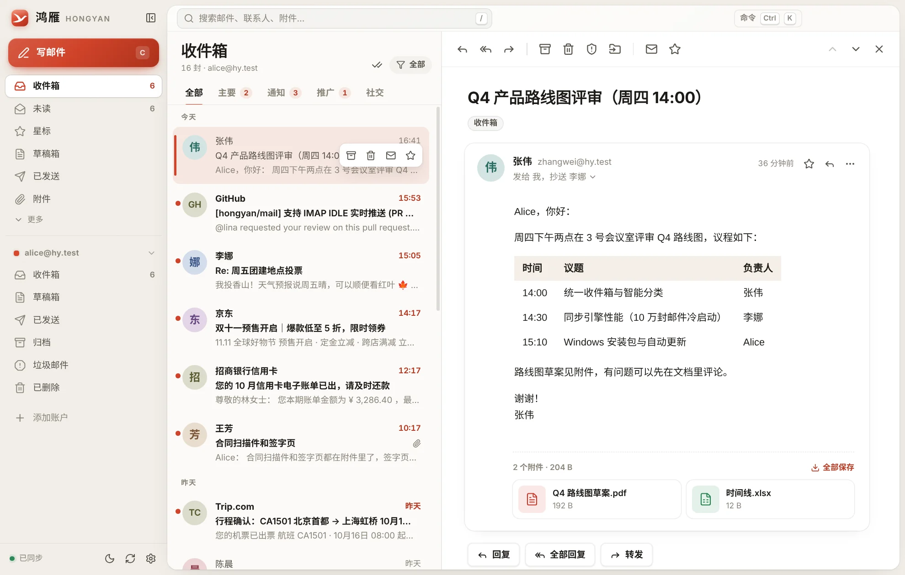

| 首次启动 | 逐项连接诊断 | 失败时给出原因与办法 |
| --- | --- | --- |
| 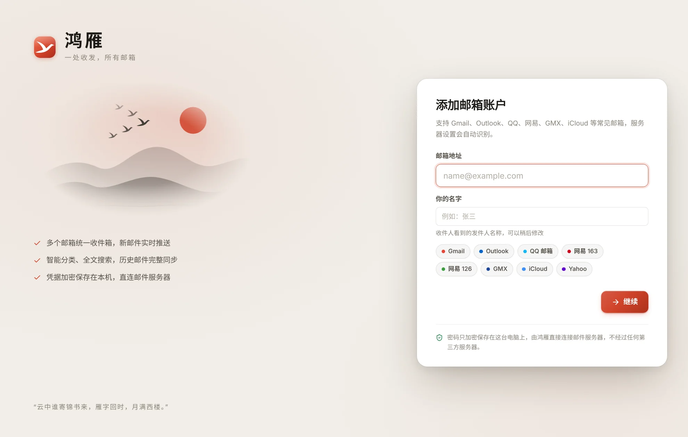 | 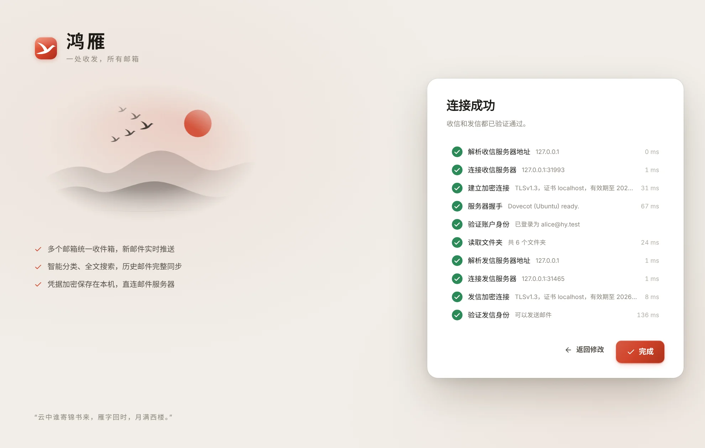 | 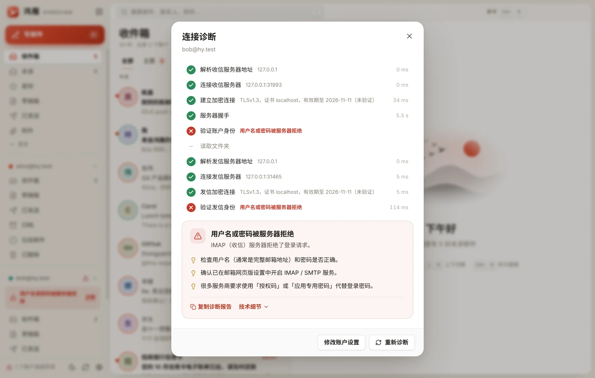 |
| **会话视图** | **远程图片默认拦截** | **撰写** |
| 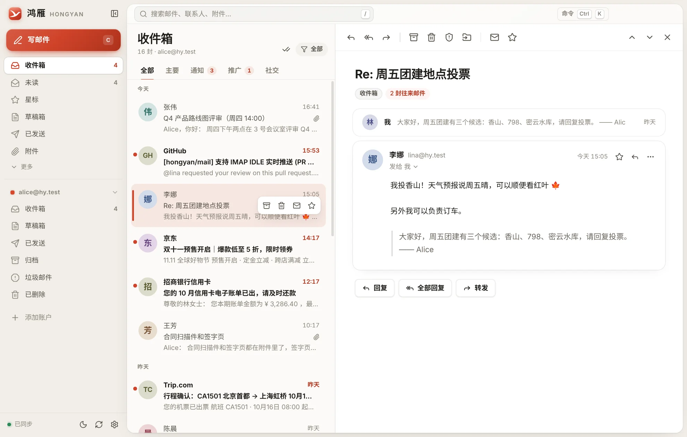 | 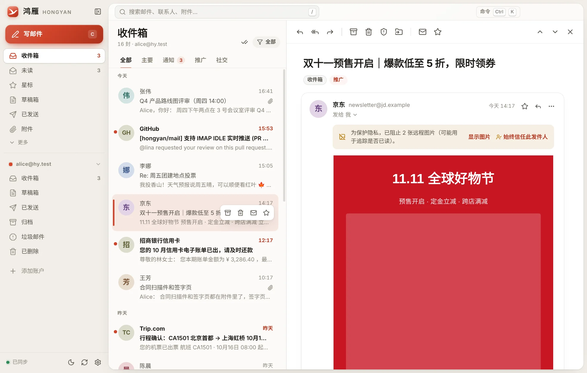 | 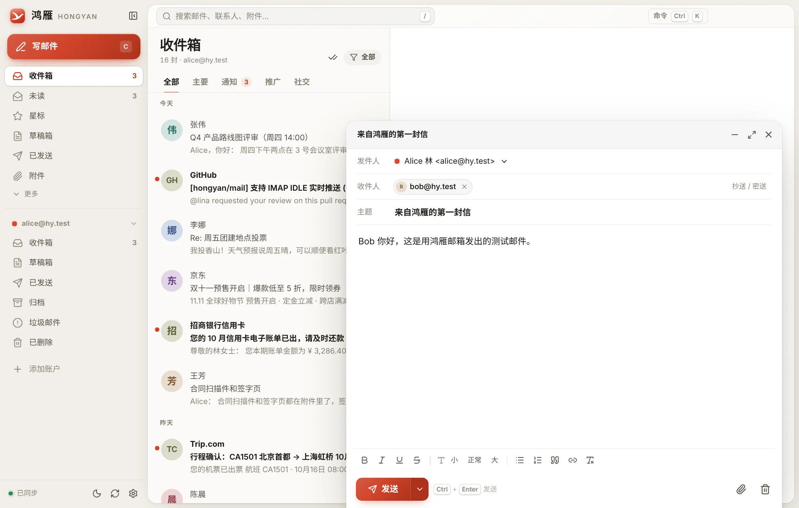 |
| **统一收件箱（多账户）** | **中文全文搜索** | **发件箱与失败重试** |
| 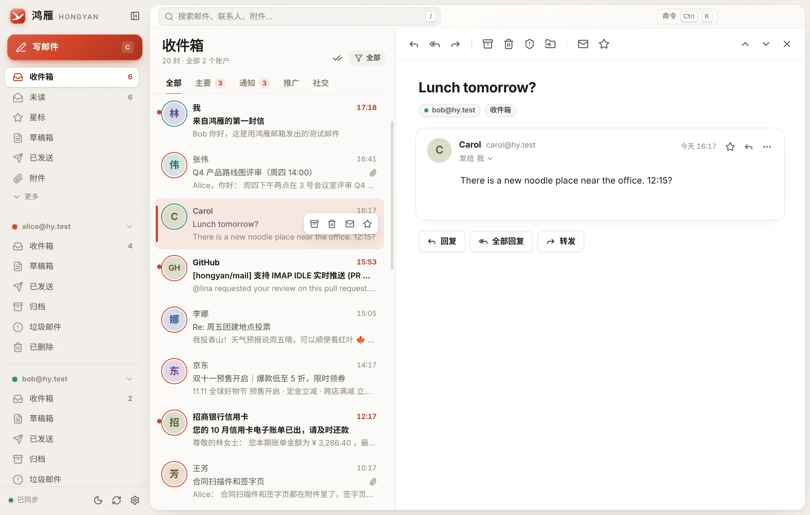 | 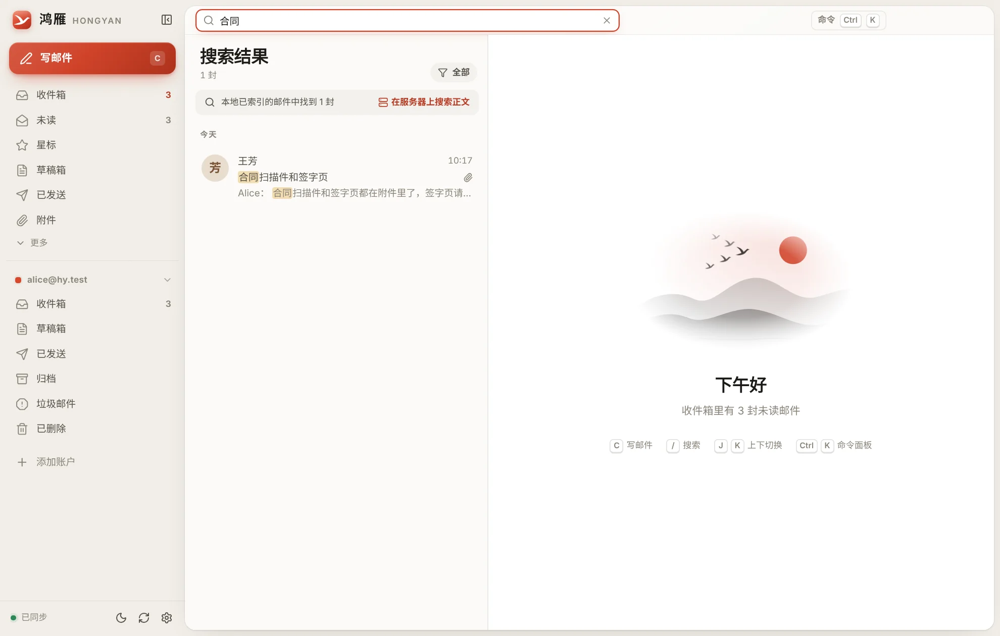 | 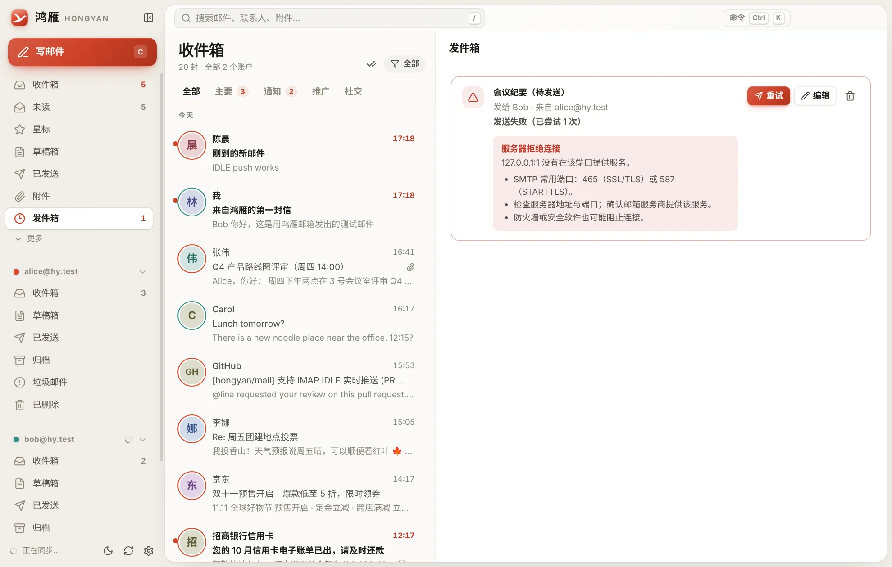 |
| **深色模式** | **外观设置** | |
| 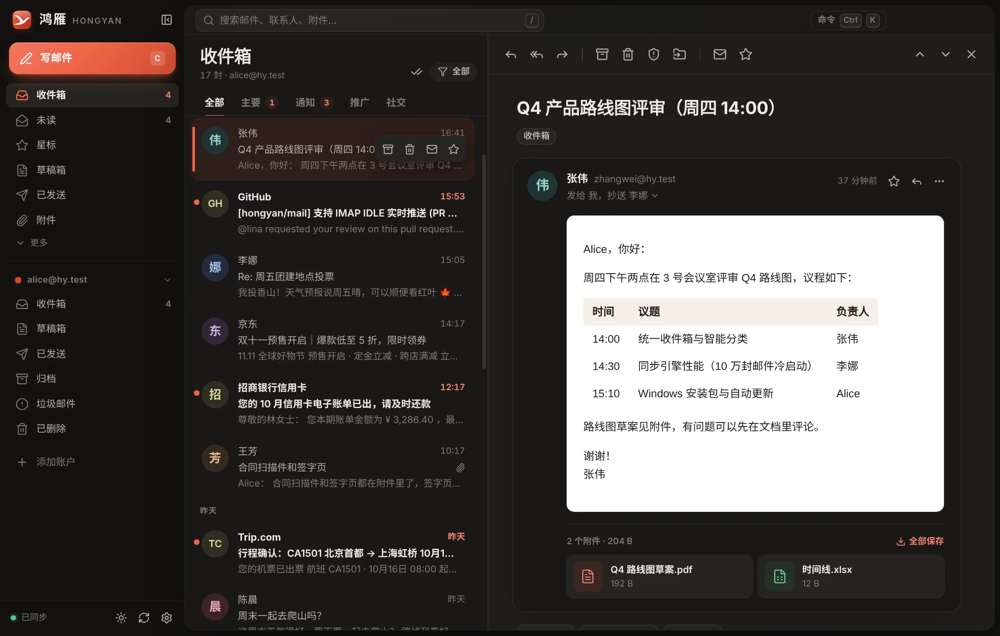 | 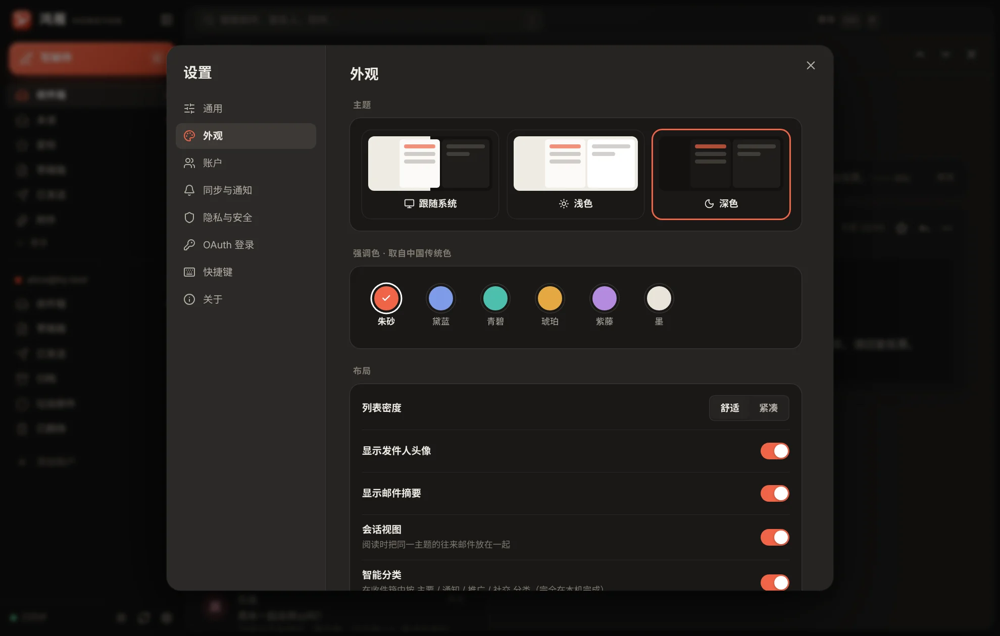 | |

---

## 下载与安装

安装包由 GitHub Actions 从本目录源码构建，跑过类型检查、单元测试和打包后的启动测试，并用仓库证书签名，发布在 Releases 的 `hongyan-mail-v*`（下载 `HongyanMail-Setup-<版本>.exe`）。安装到当前用户目录，不需要管理员权限；装好后会自己下载并安装新版本（下载好后弹窗询问是否重启，不理会则在下次退出时安装）。便携版 zip 解压即用，数据保存在同目录的 `data` 文件夹，不自动更新。流程见 [scripts/windows-release/](../scripts/windows-release/README.md)。

早先提交在分支里的历史安装包曾被 Defender 报告 `Trojan:Win32/Sabsik.FL.A!ml`，真伪未确认；它仍然隔离、不提供下载，与现在从源码重新构建的签名安装包无关，详见 [隔离记录](QUARANTINE.md)。

本项目是 Electron / Node.js 桌面客户端，需要本地运行环境和 IMAP / SMTP 邮件连接；GitHub Pages 不能运行邮件后端。截图来自仓库测试服务器的虚构数据。

源码只读审查发现：OAuth 设置中的 `clientSecret` 会写入本地明文设置，邮件正文缓存为 `.eml`；系统密钥库不可用时，备用密钥和密文位于同一数据目录。处理重要账号前请先了解这些限制。

## 功能

**收信与同步**
- 多账户统一收件箱，每个账户用颜色区分；也可按账户、文件夹单独查看
- 新邮件通过 IMAP IDLE **实时推送**，并有桌面通知、任务栏未读角标和托盘提示
- **完整同步历史邮件**：先拉取最新邮件立即可用，历史邮件在后台按批次补齐，进度显示在侧栏
- 增量同步：CONDSTORE 只取变化的标记；其他设备上的已读、星标、删除、移动都会同步回来
- 断网、休眠唤醒、服务器断开后自动重连（指数退避），离线时可阅读已缓存的邮件

**阅读**
- 会话视图：同一主题的往来邮件（跨文件夹）合并展示，未读的自动展开
- HTML 邮件在**无脚本的沙箱**中渲染；远程图片默认拦截（防止已读追踪），可单次显示或信任发件人
- 引用的历史内容自动折叠；超宽的营销邮件自动缩放适配；悬停链接时显示真实地址（防钓鱼）
- 附件卡片：图片缩略图与大图预览、打开、另存为、全部保存；打开可执行文件前会提示风险
- 一键退订（List-Unsubscribe）、查看原始邮件、导出 .eml、打印

**整理与搜索**
- 智能分类：收件箱按 **主要 / 通知 / 推广 / 社交** 分组（完全在本机根据邮件头判断），可把某个发件人固定归类
- 归档、删除、垃圾邮件、移动到文件夹，均可**撤销**；支持拖拽邮件到侧栏文件夹、多选批量操作
- 新建 / 重命名 / 删除文件夹；整个文件夹标为已读
- 本地全文搜索（SQLite FTS5 trigram，中文任意长度可搜），支持 `from:` `to:` `subject:` `has:attachment` `is:unread` `is:starred` `in:sent` `after:2024-01-01` `before:` `newer_than:7d` `category:` 等条件，也支持中文写法如 `发件人：张伟`；还可以一键**在服务器上搜索正文**

**撰写**
- 富文本编辑（粗体、列表、引用、链接、字号），粘贴图片直接内嵌
- 收件人自动补全（按往来频率排序），抄送 / 密送，切换发件账户时自动替换签名
- 拖拽或选择附件；超过 25 MB 时提醒；正文提到「附件」却没有添加时提醒；无主题时确认
- **撤销发送**（默认 5 秒，可设 0–30 秒）、**定时发送**、发件箱（失败自动重试并显示原因）
- 草稿自动保存在本机，关闭时同步到服务器的草稿箱；回复 / 全部回复 / 转发（含原附件）

**体验**
- 浅色「宣纸」与深色「墨」两套主题，跟随系统；六种取自中国传统色的强调色（朱砂、黛蓝、青碧、琥珀、紫藤、墨）
- 舒适 / 紧凑两种密度；可拖拽的列表宽度；可折叠的侧栏；Windows 原生标题栏按钮（含贴靠布局）
- 命令面板 <kbd>Ctrl</kbd>+<kbd>K</kbd> 与完整的键盘快捷键（按 <kbd>?</kbd> 查看）
- 关闭窗口后在托盘中继续收信；可开机自动启动；可设为系统默认邮件程序（mailto:）

### 快捷键

| 键 | 操作 | 键 | 操作 |
| --- | --- | --- | --- |
| <kbd>C</kbd> | 写邮件 | <kbd>J</kbd> / <kbd>K</kbd> | 下一封 / 上一封 |
| <kbd>R</kbd> / <kbd>A</kbd> / <kbd>F</kbd> | 回复 / 全部回复 / 转发 | <kbd>/</kbd> | 搜索 |
| <kbd>E</kbd> | 归档 | <kbd>Del</kbd> | 删除 |
| <kbd>S</kbd> | 星标 | <kbd>U</kbd> | 已读 / 未读 |
| <kbd>V</kbd> | 移动到文件夹 | <kbd>!</kbd> | 垃圾邮件 |
| <kbd>G</kbd> <kbd>I</kbd> | 前往收件箱 | <kbd>Ctrl</kbd>+<kbd>Enter</kbd> | 发送 |
| <kbd>Ctrl</kbd>+<kbd>K</kbd> | 命令面板 | <kbd>F5</kbd> | 立即收取 |

## 添加邮箱

输入邮箱地址后，鸿雁会自动识别服务器配置：先查内置的 30 多家服务商资料，再查该域名的 MX 记录（识别 Google Workspace、Microsoft 365、腾讯企业邮、网易企业邮、阿里企业邮等托管域名）、域名自己的自动配置文件和 Mozilla ISPDB 公共配置库（只发送域名，可在设置中关闭），最后按常见命名规则探测。任何时候都可以展开「服务器设置」手动填写。

各服务商需要的凭据（鸿雁在添加时会给出同样的步骤说明和设置页面链接）：

| 服务商 | 需要填写 | 准备工作 |
| --- | --- | --- |
| **QQ 邮箱 / Foxmail** | 授权码 | mail.qq.com → 设置 → 账号与安全，开启 IMAP/SMTP 服务并生成 16 位授权码 |
| **网易 163 / 126 / yeah.net** | 授权码 | 网页版 设置 → POP3/SMTP/IMAP，开启 IMAP/SMTP 服务并获取授权码 |
| **Gmail** | 应用专用密码，或 OAuth2 | 开启两步验证后在 myaccount.google.com/apppasswords 创建；或使用「Google 账号登录」 |
| **GMX** | 账户密码 | 网页版设置中勾选「Allow access via POP3 and IMAP」（默认关闭） |
| **Outlook / Hotmail / Microsoft 365** | OAuth2 | Microsoft 已停用密码登录，需要「Microsoft 账号登录」（见下文） |
| **iCloud / Yahoo / AOL / Yandex / Fastmail** | 应用专用密码 | 在各自账户安全设置中生成 |
| 腾讯企业邮、新浪、搜狐、139、189、阿里、Zoho、WEB.DE、mail.com、Proton Bridge 等 | 见添加时的提示 | |

### 连接失败时

添加账户和「诊断连接」都会逐项检查并显示耗时：解析服务器地址 → TCP 连接 → TLS 加密与证书 → 服务器握手 → 身份验证 → 读取文件夹 → 发信服务器的同样步骤。失败时给出**具体原因和可操作的建议**，例如：

- 「QQ 邮箱需要授权码」——使用了 QQ 密码，或 IMAP 服务未开启
- 「Gmail 需要应用专用密码」「Outlook 需要使用 Microsoft 账号登录」「网易邮箱判定为不安全登录」
- 「加密方式与端口不匹配」（993/465 用 SSL/TLS，143/587 用 STARTTLS）
- 「无法验证服务器证书」（可能是杀毒软件的邮件扫描替换了证书）、「证书已过期」、「证书与服务器地址不符」
- 「找不到服务器」「服务器拒绝连接」「连接超时」「服务器暂时限制了访问」
- 发信时的「收件人地址被拒绝」「邮件过大」「被判定为垃圾邮件」「已超出发送限额」「发件人地址不被允许」

诊断报告可一键复制（不含密码）。账户出错时侧栏会显示原因，点击即可诊断。

### OAuth2（Google / Microsoft 账号登录）

OAuth2 授权在系统浏览器中完成，结果通过本机回环地址（`http://127.0.0.1:随机端口`）直接交给鸿雁，使用 PKCE，**不经过任何第三方服务器**，令牌加密保存在本机并自动续期。

OAuth2 需要一个「客户端 ID」。OAuth 客户端必须由发布者向 Google / Microsoft 注册，开源程序无法合规地内置别人的客户端，因此首次使用时请在 **设置 → OAuth 登录** 中填写自己的客户端 ID（免费、一次性，设置页面有逐步说明）：

- **Google**：Google Cloud 控制台 → 启用 Gmail API → OAuth 同意屏幕（外部，把自己加为测试用户）→ 创建「桌面应用」类型的 OAuth 客户端，填写客户端 ID 与密钥。Gmail 也可以直接用应用专用密码，无需此步。
- **Microsoft**：Microsoft Entra「应用注册」→ 新注册（任何组织目录 + 个人 Microsoft 帐户）→ 身份验证中添加「移动和桌面应用程序」平台，重定向 URI `http://localhost`，开启「允许公共客户端流」→ API 权限添加 `IMAP.AccessAsUser.All`、`SMTP.Send`、`offline_access` → 填写应用程序（客户端）ID。

如果你要分发自己构建的版本，可以把客户端 ID 预置在设置默认值中（`src/main/core/settings.ts`），用户就无需配置。

## 隐私与安全

- **本地运行**：没有后端、没有账号、没有统计上报。鸿雁只连接你的邮件服务器；唯一可选的其他请求是用域名查询 Mozilla ISPDB（可关闭）。
- **凭据加密**：密码和 OAuth 令牌在写入磁盘前用 Windows DPAPI（Electron `safeStorage`）加密，只有当前 Windows 用户能解密；日志会抹去密码与令牌。
- **安全渲染**：界面进程启用 `contextIsolation` + `sandbox`，严格的内容安全策略；邮件 HTML 经 DOMPurify 净化后放进无脚本、无表单的沙箱 iframe；内嵌图片走带 HMAC 令牌的内部协议，一封邮件无法读取另一封邮件的附件；除用户允许的图片与字体外，阻止邮件发起任何网络请求。
- **数据位置**：`%APPDATA%\Hongyan Mail`（数据库 `hongyan.db`、邮件原文缓存 `mail\`、日志 `logs\`），在 设置 → 隐私与安全 中可直接打开。

## 技术架构

```
Electron 44（Chromium 152 + Node 24）
├─ 主进程  src/main
│  ├─ core/            与 Electron 无关、可独立测试的核心
│  │  ├─ mail-core.ts  账户、操作（乐观更新 + 撤销）、发件箱、草稿、附件
│  │  ├─ sync.ts       每账户一个工作连接 + 优先级任务队列；独立 IDLE 连接负责推送
│  │  ├─ store.ts      node:sqlite（WAL）数据访问；FTS5 trigram 全文索引；跨文件夹去重
│  │  ├─ discovery.ts / providers.ts   服务器自动识别
│  │  ├─ diagnose.ts / explain.ts      逐项诊断与错误解释
│  │  ├─ oauth.ts      OAuth2 PKCE + 回环重定向
│  │  ├─ smtp.ts       nodemailer 发信与 MIME 组装
│  │  └─ classify.ts / mime.ts         智能分类、预览摘要、线程
│  ├─ index.ts         窗口、托盘、通知、协议（app:// 与 hy-att://）、IPC
│  └─ secrets.ts       safeStorage(DPAPI) 凭据加密
├─ 预加载 src/preload  唯一的 IPC 桥（contextBridge）
└─ 界面   src/renderer React 19 + zustand + motion；虚拟滚动列表；纯 CSS 设计令牌
```

- 依赖全部打包进单个文件，**没有任何原生模块**（数据库使用 Electron 内置 Node 的 `node:sqlite`），因此可以在任何系统上构建 Windows 安装包。
- IMAP：[imapflow](https://github.com/postalsys/imapflow)；SMTP 与 MIME：[nodemailer](https://nodemailer.com)、[mailparser](https://github.com/nodemailer/mailparser)。

## 开发、测试与打包

需要 Node.js ≥ 22。

```bash
cd hongyan-mail
npm install
npm run dev          # Vite 热更新 + Electron
npm run typecheck
npm test             # 单元测试（90 个）
npm run dist:win     # 生成 release/ 下的安装包（Windows 上；其他系统加 --installer 并需要 Wine）与便携版
```

**集成测试与端到端测试**使用本地的 Dovecot IMAP 服务器和 SMTP 服务器（`scripts/test-server/`，需要 `apt install dovecot-imapd`，以 root 运行）：

```bash
npm run test:integration          # 25 个：诊断各类错误、同步、标记、移动/撤销、IDLE 推送、
                                  # 发信与已发送、撤销发送、搜索、历史补齐、文件夹、草稿、发件箱重试
xvfb-run -a npm run test:e2e      # 17 步：驱动真正的 Electron 程序完成添加账户、阅读、搜索、
                                  # 发信、撤销、推送、深色模式、设置、诊断、多账户，并截图
npm run mail-server               # 只启动测试邮件服务器，方便手动体验
```

每次发布前，「hongyan-mail · Windows build」工作流在 Windows 上构建并检查：签名、自动更新文件、打包程序与静默安装后的程序都能启动到欢迎界面，卸载干净。

## 已知限制

- 仅支持 IMAP / SMTP（不支持 POP3、Exchange EWS / ActiveSync），不含日历与通讯录同步。
- Outlook 个人账户必须使用 OAuth2，需要先配置客户端 ID（见上文）。
- 安装包使用自签名证书签名；没有导入这张证书的电脑首次运行仍可能出现 SmartScreen 提示。
- 便携版不会在开始菜单创建快捷方式，Windows 可能因此不显示新邮件通知。
