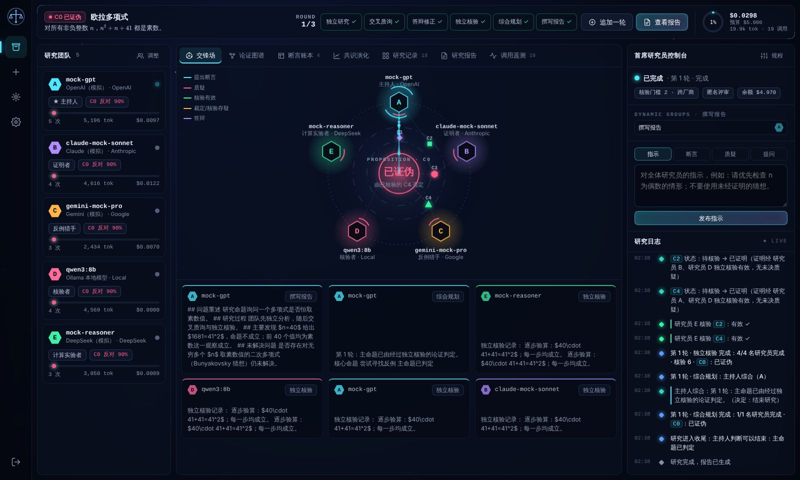
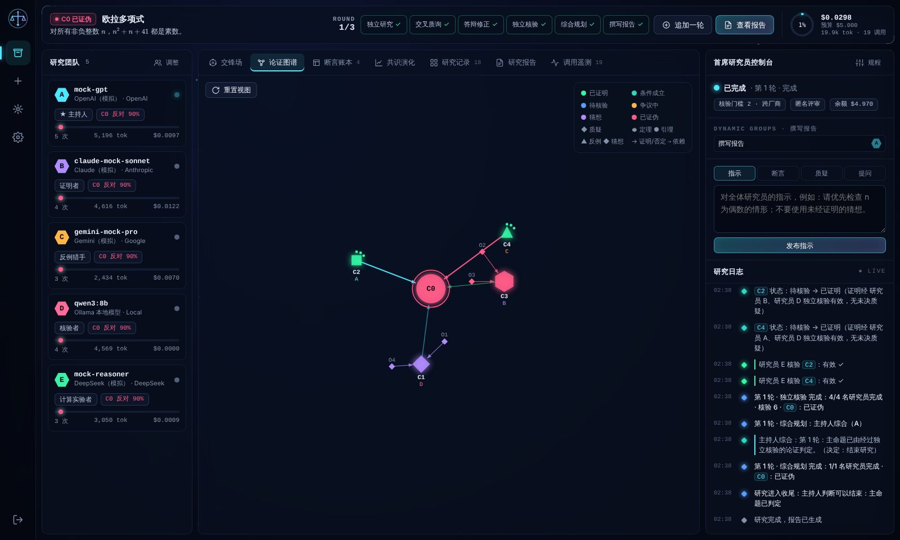
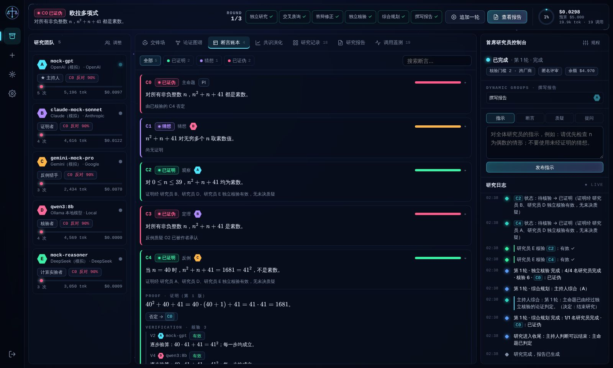
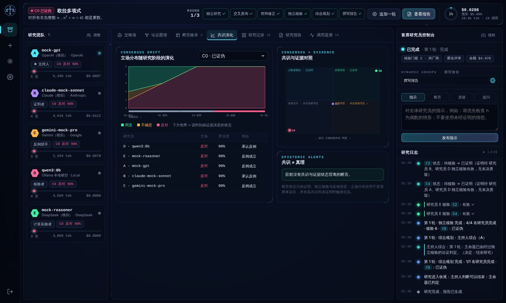
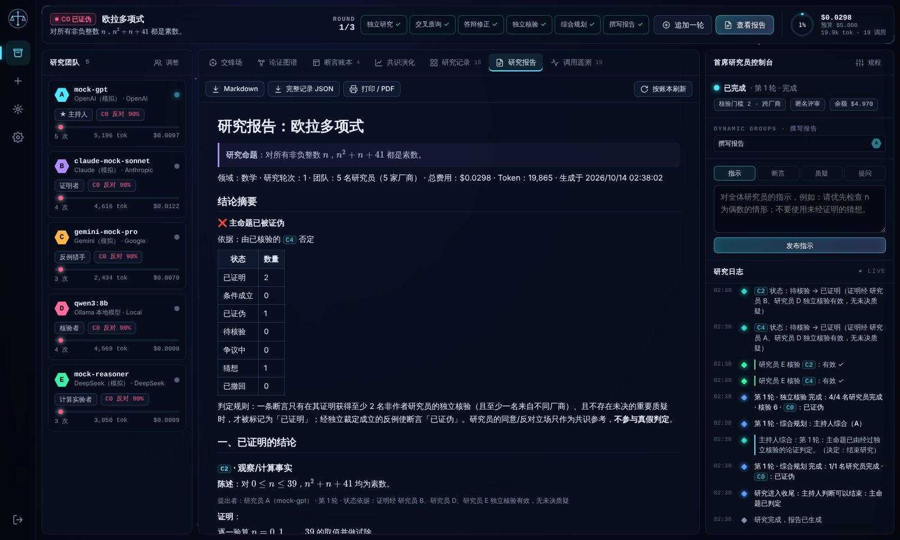

# 论衡 Lunheng · 多智能体学术辩论与研究实验室

> 真理不由多数决定。

论衡让 5–10 个来自不同厂商的 AI 模型组成研究团队，围绕数学、物理、计算机科学等学术命题开展多轮研究：先各自独立推导，再交叉质询、寻找反例、答辩修正、由非作者独立核验，最后生成研究报告。报告分别列出已证明结论、已证伪断言、猜想和未解决问题。

所有模型调用都由服务器真实发出：每个平台按其原生协议与认证方式分别适配，API Key 加密存储在服务器端，不会发送到浏览器。



| 论证图谱 | 断言账本 |
| --- | --- |
|  |  |
| **共识演化** | **研究报告** |
|  |  |

> 截图中的研究由仓库自带的**协议模拟服务器**驱动（用于测试，见下文），因此模型名为 `mock-*`。连接真实 API Key 后，界面与流程完全相同。

---

## 快速开始

```sh
cd lunheng
npm ci            # 依赖：quickjs-emscripten（计算沙箱）、KaTeX、marked、DOMPurify
npm start         # 默认 http://127.0.0.1:8848
```

需要 Node.js ≥ 20.11，推荐 22 LTS。

1. 打开 `http://127.0.0.1:8848`，注册账户（第一个账户即可使用全部功能）。
2. **接入中心** → 「添加服务商」→ 选择平台 → 填写 API Key（必要时修改 Base URL 与模型 ID）→「测试连接」。
3. **新建研究** → 写下命题（支持 LaTeX）→ 组建 5–10 人团队（尽量来自不同厂商）→ 设定规程与预算 →「创建并开始研究」。
4. 在研究控制台实时观看推导与交锋，可以随时暂停、单步推进、发布指示、提出质疑或向某位研究员提问。

需要通过代理访问海外 API 时，设置 `HTTPS_PROXY` 后运行 `npm start` 即可。启动器会自动为 Node 内置 `fetch` 打开环境代理支持（`NODE_USE_ENV_PROXY=1`，Node ≥ 22.21 / 24）。

## 支持的平台

| 平台 | 协议 | 默认 Base URL | 认证 | 深度思考参数 |
| --- | --- | --- | --- | --- |
| OpenAI（GPT） | Chat Completions SSE | `https://api.openai.com/v1` | `Authorization: Bearer` | `reasoning_effort`（o 系列 / GPT-5 自动改用 `max_completion_tokens`、去掉温度） |
| Anthropic（Claude） | Messages API SSE | `https://api.anthropic.com` | `x-api-key` + `anthropic-version` | 新模型 `thinking: adaptive`（显示思考摘要）+ `output_config.effort`；旧模型 `budget_tokens` |
| Google（Gemini） | `streamGenerateContent?alt=sse` | `https://generativelanguage.googleapis.com` | `x-goog-api-key` 请求头（不放进 URL） | `thinkingConfig`（`includeThoughts`、2.5 用 `thinkingBudget`、3 用 `thinkingLevel`） |
| DeepSeek | OpenAI 兼容 | `https://api.deepseek.com` | Bearer | `deepseek-reasoner` 流式 `reasoning_content` |
| 通义千问 Qwen | OpenAI 兼容（百炼 compatible-mode） | `https://dashscope.aliyuncs.com/compatible-mode/v1`（可切换国际站） | Bearer | `enable_thinking` |
| Kimi（Moonshot） | OpenAI 兼容 | `https://api.moonshot.cn/v1`（可切换 .ai） | Bearer | 思考模型 `kimi-k2-thinking`；温度限制在 0–1 |
| 智谱 GLM | OpenAI 兼容 | `https://open.bigmodel.cn/api/paas/v4`（可切换 Z.ai） | Bearer，或由 `id.secret` 签名的 JWT | `thinking.type` |
| 豆包（火山方舟） | OpenAI 兼容 | `https://ark.cn-beijing.volces.com/api/v3` | Bearer | `thinking.type`；模型 ID 也可填接入点 `ep-…` |
| xAI Grok | OpenAI 兼容 | `https://api.x.ai/v1` | Bearer | 推理内容 `reasoning_content` |
| Ollama 本地模型 | 原生 `/api/chat` NDJSON | `http://127.0.0.1:11434` | 无（可选 Bearer，用于反向代理） | `think`；自动设置 `num_ctx`（默认 16K） |
| 自定义 · OpenAI 兼容 | Chat Completions | 任意（OpenRouter、OneAPI/NewAPI、vLLM、LM Studio、Azure 兼容端点…） | Bearer / `api-key` / `x-api-key` / 无 | 可选 |
| 自定义 · Anthropic 兼容 | Messages API | 任意中转 | `x-api-key` / Bearer | Claude 风格 |
| 自定义 · Gemini 兼容 | generateContent | 任意中转 | `x-goog-api-key` / Bearer | Gemini 风格 |

接入中心支持：

- 同时配置任意多个服务商，同一家可以配置多个账号或中转。研究团队中的每位研究员可以使用任何服务商的任何模型，暂停期间还能更换。
- 「拉取模型列表」调用各平台的模型目录接口：OpenAI 兼容用 `/models`，Anthropic 用 `/v1/models`，Gemini 用 `/v1beta/models` 并只保留可生成内容的模型，Ollama 用 `/api/tags`。
- 每个模型可以单独设置输入/输出价格（USD 或 CNY，每百万 token）和附加请求体字段，用于厂商特有参数，例如 `{"top_p": 0.9}`。
- 自定义请求头（加密保存）与附加查询参数（如 Azure 的 `api-version`）。
- 「测试连接」发送一条最小的流式请求，显示首 token 延迟、总耗时、用量和费用。

### 参数差异自动适配

各家对参数的支持不同，例如 o 系列不接受 `max_tokens`，部分中转拒绝 `stream_options`，部分模型不支持思考参数。网关收到 400 错误后，会根据错误信息调整请求，例如改用 `max_completion_tokens`，或去掉 `temperature`、`stream_options`、`enable_thinking`、`thinkingConfig`、`think`，然后立即重发。调整结果会按“服务商 × 模型”记住，之后的请求直接使用正确参数。

## 研究规程

每一轮研究依次经过五个阶段。第一轮从“独立研究”开始，之后的轮次从“专项攻关”开始：

| 阶段 | 参与者 | 内容 |
| --- | --- | --- |
| 独立研究 | 全员，彼此不可见 | 澄清定义，尝试证明或构造反例，把论证拆成可核验的断言 |
| 专项攻关 | 动态分组 | 证明组、反驳组、计算组、复核组；主持人可以指定任务 |
| 交叉质询 | 每条断言 2 名审查者（可调） | 优先分配持反对立场者、来自不同厂商者和反例猎手；可以提出反例、缺口、错误、歧义或适用范围质疑 |
| 答辩修正 | 被质疑的作者 | 承认、反驳，或修订陈述与证明（产生新版本） |
| 独立核验 | 非作者核验者，优先不同厂商 | 逐行核验，给出“有效 / 有缺口 / 有错误 / 陈述为假 / 无法核验”；对质疑作出“成立 / 驳回”裁定 |
| 综合规划 | 主持人 | 依据账本状态总结本轮，设定下一轮重点，分配任务，判断是否结束 |

研究在达到最大轮数时结束，也可以在主命题已判定且没有待处理论证时提前结束，或由首席研究员手动结束。随后主持人撰写报告的叙述部分。

### 研究员角色

主持人、证明者、反例猎手、核验者、计算实验者、理论家、魔鬼代言人、通才研究员。角色决定提示词的侧重点和调度优先级，**不影响证据的权重**。

### 证据规则：共识 ≠ 真理

每条断言的状态由确定性的规则从账本计算，模型无法直接声明状态：

| 状态 | 条件 |
| --- | --- |
| **已证明** | 有证明，获得至少 N 名**非作者**研究员的“有效”核验（默认 N = 2，可选要求至少一名来自不同厂商），且没有未决的重要质疑或证明缺口 |
| **条件成立** | 证明已通过核验，但依赖尚未证明的断言 |
| **已证伪** | 反例质疑被作者承认或经独立裁定成立；或被已证明的反驳断言否定；或它所蕴含的命题已被证伪（否定后件） |
| **争议中** | 存在尚未定论的重要质疑（包括裁定意见不一致） |
| **待核验** | 有证明，但核验人数不足 |
| **猜想** | 没有证明，或证明的缺口已被确认 |
| **矛盾** | 同一命题同时存在已核验的证明和已核验的否定，交由人工审查 |

另有三条规则保证核验的独立性：作者不能核验自己的断言；被质疑的一方不能裁定针对自己的质疑；提出质疑的人只能撤回自己的质疑，不能裁定它成立。

研究员的“同意 / 反对”立场会单独记录并绘制成共识演化曲线，**但不参与任何状态判定**。一个经核实的反例足以推翻全体同意的断言。当某条未证明断言获得 ≥80% 的同意时，系统会触发**共识警报**，自动指派红队专门尝试反驳它。

匿名评审默认开启：研究员只看到“研究员 A / B / C”，从而按论证内容而不是模型品牌作出判断。

### 标记协议

研究员用 Markdown 自由论述，用 XML 风格的标记记录结构化贡献，例如 `<claim>`、`<objection>`、`<response>`、`<verdict>`、`<ruling>`、`<stance>`、`<compute>`。论衡不用 JSON，因为 JSON 字符串会把 `\frac`、`\neq`、`\binom` 中的反斜杠当作转义字符而悄悄损坏 LaTeX，标记内则可以直接书写 LaTeX。回答没有使用标记时，系统会追加一次低成本的格式修复请求。

### 计算核验沙箱

研究员可以提交 JavaScript 代码（`<compute>`），例如穷举小规模情形或验算反例。代码在 **QuickJS（WebAssembly）** 中运行，不能访问 Node API、文件系统或网络，单次运行有时间和内存上限，并在独立的 Worker 线程中执行，超时后强制终止。运行结果作为证据记入账本，交还给研究员后再给出最终结论。数值证据可以否定断言，但不能代替证明，除非已经穷尽全部有限情形。

### 研究报告

报告的权威章节由账本**确定性生成**：结论摘要、已证明、条件成立、已证伪、猜想、待核验与争议、未解决问题、共识与证据的偏差、计算证据、团队与调用统计、研究时间线。主持人撰写的叙述单独成章，并注明“以账本章节为准”，因此模型无法在报告中把猜想写成定理。报告可以导出为 Markdown、完整 JSON 记录，或打印为 PDF。

## 自主研究与人工干预

- **自动推进 / 单步 / 暂停 / 中止**：暂停时，进行中的调用会完成；中止时，进行中的调用会被取消，继续研究时重做。服务器重启后，研究自动处于暂停状态，可以从断点继续。
- **首席研究员控制台**：
  - 发布指示：注入之后所有提示，可以随时停用。
  - 提出断言：PI 提出的断言同样需要独立核验。
  - 提出质疑：作者会在答辩阶段回应。
  - 向某位研究员提问：回答中的标记会进入账本。
- **调整团队**：暂停期间可以更换模型、调整角色、让研究员离任或加入新研究员。
- **调整规程**：随时修改轮次、核验门槛、预算、并发等设置。研究完成后可以“追加一轮”继续。
- **研究档案**：所有研究持久保存，可以复制为新研究、导出或删除。

## 可视化

- **交锋场**：研究员排列在提案核心周围。思考中、输出中的研究员会脉冲闪烁；断言围绕核心按状态着色；每一次提出断言、质疑、核验、裁定、答辩都会在研究员之间发出光束。下方实时滚动各模型的流式输出和思考过程。
- **论证图谱**：力导向图，展示断言之间的证明、否定、依赖关系与质疑，支持缩放、拖拽和点击查看详情；节点形状表示断言类型，周围的绿点表示有效核验数。
- **断言账本**：按状态筛选，查看版本历史、质疑线程、核验记录、计算证据和立场。
- **共识演化**：立场分布随阶段变化的面积图，下方色带是同一时刻由证据决定的状态；另有“共识 × 证据”对照图和认知警报。
- **研究记录**：轮次与阶段 × 研究员的矩阵，点击可以查看渲染后的完整贡献，包括思考过程、计算结果和格式修复。
- **调用遥测**：调用数、Token、费用、平均延迟、首 token 时间、失败与重试；按模型汇总，并提供完整调用日志。

## 调用管理

- **并发**：研究级并发上限与服务商级并发上限（信号量）同时生效。
- **流式**：四种协议均使用流式响应，思考内容（`reasoning_content`、Claude `thinking_delta`、Gemini `thought` 部分、Ollama `thinking`）单独呈现；内联 `<think>…</think>` 也会被拆分出来。
- **失败重试**：429、5xx、529 过载、网络错误、空闲超时与流中断都会自动重试，采用指数退避加随机抖动，并遵循 `Retry-After`。认证、额度、请求参数错误不重试；以 429 返回的余额不足也不重试。
- **Token 与费用**：读取各协议的真实用量（Gemini 思考 token 按输出计费）；服务商不返回用量时按文本估算，并标注“估算”。CNY 计价模型按账户设置的汇率换算。
- **预算限制**：每次调用前预留最坏情况费用（估算输入 + 输出上限），因此并发调用也不会超出预算。可以分别设置研究级美元预算、Token 上限和账户总预算；超出时研究自动暂停，提高预算后继续。

> 默认价格是各平台在 2025–2026 年公布的参考价，仅用于估算与预算控制，请在接入中心按实际账单修改。

## 安全

- **密钥加密**：API Key 与自定义请求头使用 AES-256-GCM 加密存储。数据密钥由服务器主密钥经 HKDF 按用户派生，密文还通过 GCM 附加数据绑定到“用户 + 服务商”，复制到其他账户或其他服务商记录中无法解密。
- **不出服务器**：浏览器只会收到掩码提示（如 `sk-••••abcd`）。所有模型请求都由服务器发出，服务商错误信息中回显的密钥片段会被去除。
- **账户隔离**：服务商、研究、用量按用户隔离，其他用户访问一律返回 404。
- **会话**：使用 scrypt 密码哈希、`HttpOnly` + `SameSite=Strict` Cookie、每会话 CSRF 令牌和 Origin 校验，并对登录与注册做频率限制。
- **页面加固**：严格的 CSP（只允许本站脚本），模型输出经 DOMPurify 净化后再渲染。
- **出站策略**：服务监听在非本机地址时，默认禁止调用内网与链路本地地址（防止 SSRF），可以用 `LUNHENG_ALLOW_PRIVATE_HOSTS=1` 放行，例如局域网中的 Ollama。

**主密钥**：设置了 `LUNHENG_MASTER_KEY`（32 字节，hex 或 base64）时使用该值；否则首次启动时生成 `data/master.key`（权限 0600）。**丢失主密钥会导致所有已保存的 API Key 无法解密**，请与 `data/` 一起备份。

**多用户部署**：放在 HTTPS 反向代理之后，并设置 `LUNHENG_HOST=0.0.0.0`、`LUNHENG_SECURE_COOKIES=1`。如需限制注册，设置 `LUNHENG_SIGNUP=invite` 与 `LUNHENG_INVITE_CODE`，或设置 `LUNHENG_SIGNUP=closed`（只允许创建第一个账户）。

## 配置

| 环境变量 | 默认 | 说明 |
| --- | --- | --- |
| `LUNHENG_HOST` / `LUNHENG_PORT` | `127.0.0.1` / `8848` | 监听地址与端口 |
| `LUNHENG_DATA_DIR` | `./data` | 用户、加密密钥库、研究记录 |
| `LUNHENG_MASTER_KEY` | 自动生成 | 32 字节主密钥 |
| `LUNHENG_SIGNUP` | `open` | `open` / `invite` / `closed` |
| `LUNHENG_INVITE_CODE` | — | `invite` 模式的邀请码 |
| `LUNHENG_ALLOW_PRIVATE_HOSTS` | 监听本机时为开 | 是否允许调用内网地址 |
| `LUNHENG_SECURE_COOKIES` | 关 | HTTPS 部署时开启 |
| `LUNHENG_SESSION_TTL_HOURS` | `168` | 登录有效期 |
| `LUNHENG_SANDBOX_TIMEOUT_MS` / `LUNHENG_SANDBOX_MEMORY_MB` | `4000` / `64` | 计算沙箱限制 |
| `HTTPS_PROXY` / `NO_PROXY` | — | 出站代理（经 `npm start` 自动启用） |

数据以 JSON 文件保存在 `data/` 中，写入时先写临时文件再原子替换：`users.json`、`users/<id>/providers.json`（加密）、`users/<id>/sessions/<id>.json`、`users/<id>/usage.json`。

## 测试与验证

```sh
npm run check      # 全部模块语法检查
npm run test:unit  # 39 个单元/集成测试：四种协议适配、重试与参数修复、预算、密钥库、账户隔离与 CSRF、账本规则、端到端研究、重启恢复
npm run test:e2e   # Playwright：注册 → 通过 UI 接入服务商并测试连接 → 向导创建 5 人研究 → 控制台各视图 → 报告
npm run probe      # 用无效密钥探测全部真实平台端点（验证网络、路径与认证头）
```

`tools/mock-providers.mjs` 是一个**协议模拟服务器**，按各家线上格式实现：

- OpenAI SSE：含 `stream_options` 用量块、`reasoning_content` 与 keep-alive 注释。
- Anthropic SSE：含 `message_start` / `content_block_delta` / `message_delta` 事件、`thinking_delta` 与 `ping`。
- Gemini SSE：使用 `\r\n` 分隔，含 `thought` 部分与 `usageMetadata`。
- Ollama NDJSON。

它也按各家的方式校验认证头，并返回各自的错误信封；还可以注入 429 + Retry-After、5xx、流中断，以及推理模型的严格参数校验。答案来自一个脚本化的“研究大脑”，用来在没有 API Key 的情况下确定性地验证完整流程。它**不是模型**，仅用于测试和界面开发：

```sh
npm run mock   # http://127.0.0.1:8849，终端会打印各协议的 Base URL 与测试 Key
```

真实平台验证：在开发环境中，用 `npm run probe` 实际请求了 Anthropic 与 Google 的线上端点。两者分别以 `401 invalid x-api-key` 和 `400 API_KEY_INVALID` 拒绝无效密钥，说明请求路径、协议与认证头格式均被正确识别。其余平台在该开发环境中被出站策略拦截，它们的适配依据各平台公开文档实现，并由上述模拟服务器覆盖。

使用自己的密钥做真实调用：

```sh
LUNHENG_KEY_DEEPSEEK=sk-... npm run probe -- deepseek
```

也可以在接入中心点击「测试连接」。

## 目录结构

```
lunheng/
├── bin/lunheng.mjs            启动器（自动启用环境代理）
├── server/
│   ├── app.mjs                HTTP API、SSE、静态文件、安全头
│   ├── users.mjs              账户、设置、累计用量
│   ├── http/auth.mjs          登录会话、CSRF、限流
│   ├── security/              密钥库（AES-GCM/HKDF）、scrypt、出站地址策略
│   ├── providers/             预设、四种协议适配器、SSE/NDJSON 解析、网关（重试/修复/并发/预算）、计价
│   └── engine/                标记协议、断言账本与证据规则、提示与账本摘要、动态分组、编排器、报告、沙箱、会话管理
├── public/                    研究控制台（原生 ES 模块，无构建步骤）
├── tools/                     协议模拟服务器、端点探测、E2E 启动器、语法检查
└── tests/                     node:test 单元/集成测试、Playwright E2E
```

## 已知限制

- 默认价格与模型列表只代表编写时各平台公开的信息。模型更新很快，请用「拉取模型列表」和价格编辑保持同步。
- 文献引用无法自动核实。研究员被要求只引用确信存在的结果并标注“需核实”，报告中的引用仍需人工检查。
- 计算沙箱只支持 JavaScript（含 BigInt），没有符号计算库。需要计算机代数系统或形式化证明（Lean、Coq）时，应把它们视为外部工具，由人工复核。
- 研究的严谨程度仍取决于所选模型的能力：账本规则能防止“多数决”和自我核验，但无法保证所有核验者都不犯同样的错误。选择来自不同厂商的模型、提高核验门槛，都能降低这种风险。
