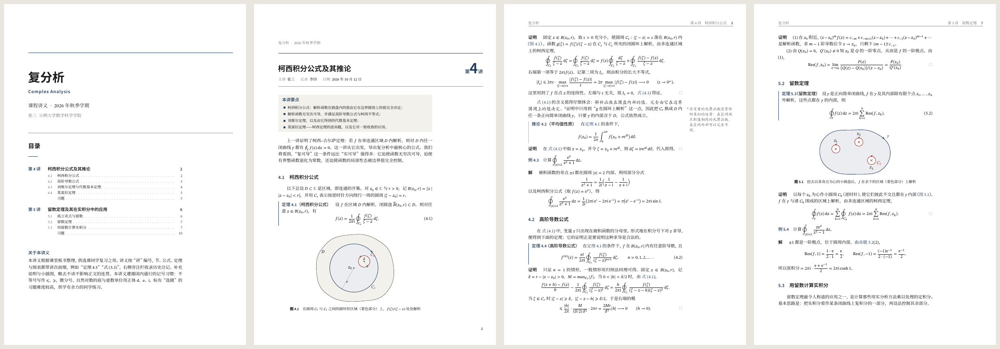
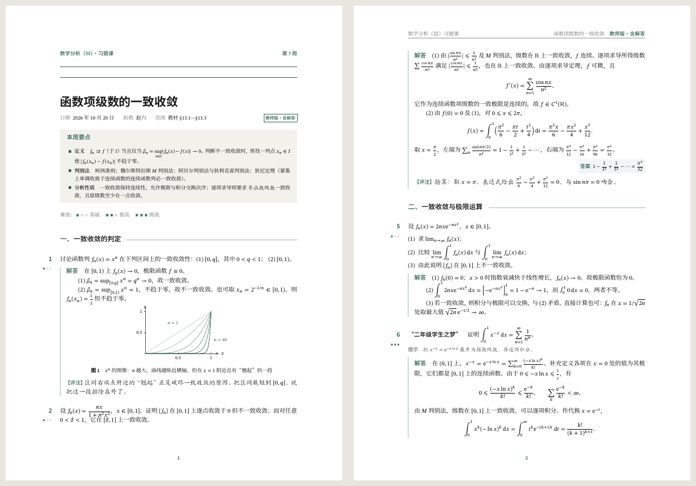
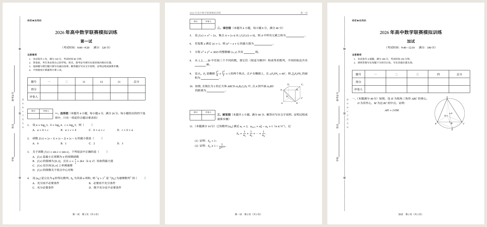
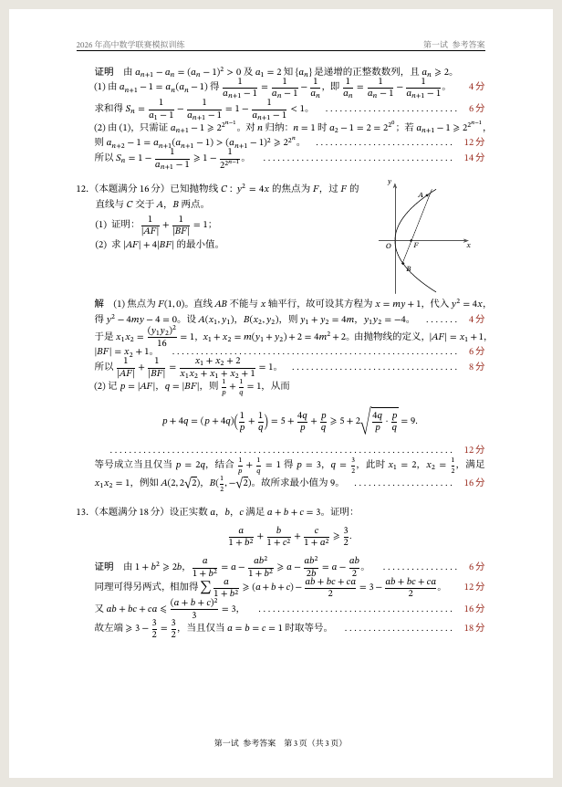
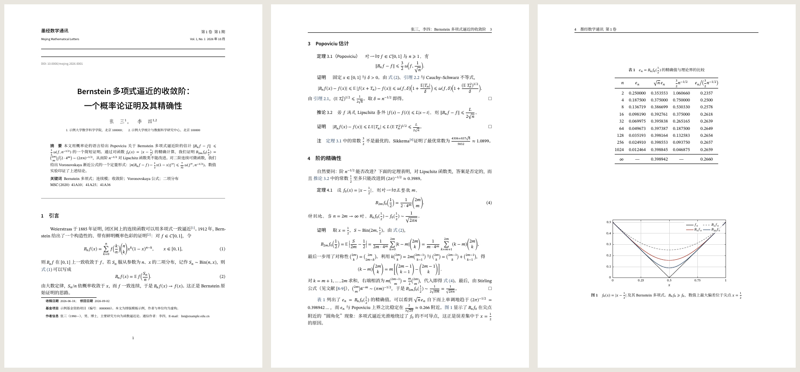
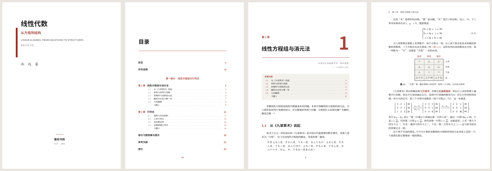
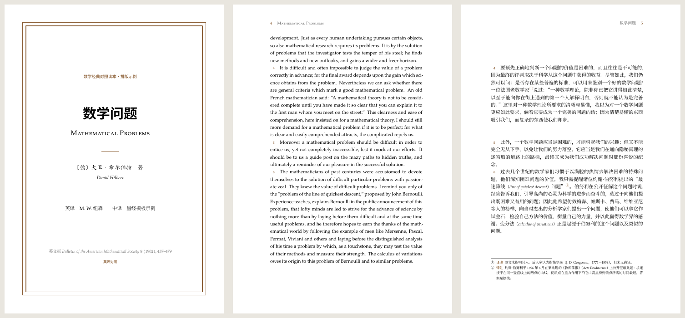

# 墨经 Mojing · 中文数学排版模板集

一套为中文数学写作设计的 LaTeX 模板，包含六种文档类：

| 模板 | 文档类 | 适用场景 | 示例内容 | PDF 预览 |
| --- | --- | --- | --- | --- |
| 数学讲义 | `mojing-notes` | 课程讲义、读书笔记、讨论班记录 | 《复分析》第 4、5 讲：柯西积分公式、留数定理 | [notes.pdf](previews/notes.pdf) |
| 习题与解答 | `mojing-exercise` | 习题课讲义、作业、题解 | 数学分析习题课：函数项级数的一致收敛 | [教师版](previews/exercise.pdf) · [学生版](previews/exercise-student.pdf) · [解答附后](previews/exercise-key.pdf) |
| 竞赛试卷 | `mojing-exam` | 竞赛、考试、模拟卷 | 高中数学联赛模拟训练（第一试 + 加试） | [试题卷](previews/exam.pdf) · [参考答案及评分标准](previews/exam-answers.pdf) |
| 数学论文 | `mojing-paper` | 期刊投稿、学位论文的章节、预印本 | Bernstein 多项式逼近的收敛阶 | [paper.pdf](previews/paper.pdf) |
| 数学书籍 | `mojing-book` | 教材、专著 | 《线性代数：从方程到结构》节选（33 页） | [book.pdf](previews/book.pdf) |
| 翻译对照 | `mojing-translation` | 译著、英汉对照读本 | 希尔伯特《数学问题》（1900）英汉对照节选 | [对照页](previews/translation.pdf) · [同页双栏](previews/translation-columns.pdf) |

六个模板共用同一套字体、配色、定理环境和数学记号，版式各有侧重。每个模板都附有一份内容完整的示例文档，
里面的数学推导、数值表和参考文献都经过核对，可以直接当作写作的起点。

名字取自先秦典籍《墨经》。书中有中国最早的一批几何定义，如“圜，一中同长也”（圆：一个中心，到中心的距离都相等）；
“墨”也是印刷的油墨。

---

## 预览

**数学讲义**：A4 单面，右侧 38 mm 旁注栏放历史注记和小插图；以“讲”为单位编号；定理左侧一条黛蓝细线。



**习题与解答**：题号与难度星级悬挂在左边距；同一份源文件输出教师版、学生版（留作答空白）和“解答附后”三种版本。



**竞赛试卷**：按正式试卷的惯例排出密封线、得分栏、“得分 / 评卷人”小表；选择题选项按长度自动排成一行四个、两个或一个；
答案版自动填入答案，并印出“……… 4 分”式的评分标准。




**数学论文**：期刊式首页（刊头、题目、摘要、关键词、MSC 分类号、首页脚注）；定理正文用楷体；参考文献按 GB/T 7714—2015 著录。



**数学书籍**：16 开双面；书名页、版权页、前言、目录、部分扉页；章首页有大号章序数、题词和本章目录；章末有分组习题和“历史注记”；书末有答案、参考文献和按拼音排序的索引。



**翻译对照**：左页原文、右页译文，段落逐一对齐并标出段落编号；译注用带圈数字，与原注分开编号；术语对照表自动生成。



---

## 快速开始

### 方式一：下载即用

`dist/` 目录下每个模板都有一个自包含的压缩包，里面有示例文档、所需的全部 `.cls`/`.sty` 文件和说明：

| 压缩包 | 内容 |
| --- | --- |
| [mojing-notes.zip](dist/mojing-notes.zip) | 数学讲义 |
| [mojing-exercise.zip](dist/mojing-exercise.zip) | 习题与解答 |
| [mojing-exam.zip](dist/mojing-exam.zip) | 竞赛试卷 |
| [mojing-paper.zip](dist/mojing-paper.zip) | 数学论文（含参考文献数据库与数据脚本） |
| [mojing-book.zip](dist/mojing-book.zip) | 数学书籍（分章源文件） |
| [mojing-translation.zip](dist/mojing-translation.zip) | 翻译对照 |

- **Overleaf**：New Project → Upload Project，选择压缩包；再到 Menu → Compiler 选择 **XeLaTeX**，点 Recompile。
- **本地**：解压后在目录里运行 `latexmk main.tex`。

### 方式二：从仓库编译

```bash
cd mojing
./build.sh            # 编译全部模板（含各种版本），PDF 输出到 previews/
./build.sh book       # 只编译某个模板
./build.sh --png      # 同时生成 previews/png/ 下的预览图（需要 pdftoppm 与 ImageMagick）
./build.sh --clean    # 清除中间文件
scripts/make-dist.sh --check   # 重新打包 dist/ 下的压缩包，并解压编译验证
```

在单个模板目录中也可以直接编译：`cd templates/paper && latexmk main.tex`。各目录下的 `latexmkrc`
已经设好 XeLaTeX，并把 `../../tex` 加入了搜索路径。

若想在任意位置使用这些文档类，把 `tex/` 下的文件复制到本地 texmf 树中即可：

```bash
mkdir -p "$(kpsewhich -var-value TEXMFHOME)/tex/latex/mojing"
cp tex/*.sty tex/*.cls "$(kpsewhich -var-value TEXMFHOME)/tex/latex/mojing/"
```

### 环境要求

- **TeX Live 2023 或更新版本**（MacTeX、MiKTeX 亦可），使用 **XeLaTeX** 编译，需要 `latexmk` 与 `biber`；
  完整安装（scheme-full）即包含所需的全部宏包与字体。
- 用到的主要宏包：ctex、fontspec、unicode-math、amsmath / mathtools / amsthm、tcolorbox、TikZ / pgfplots、
  enumitem、caption、booktabs、siunitx、fancyhdr、titletoc、hyperref / cleveref、biblatex（biblatex-gb7714-2015）、
  imakeidx、paracol、eso-pic、needspace、extarrows。
- 西文与数学字体（STIX Two、TeX Gyre Pagella / Termes、Libertinus、New Computer Modern、Latin Modern、
  Source Sans Pro、Source Code Pro）均随 TeX Live 发行，按文件名加载，无需安装到系统。

---

## 统一的设计体系

### 字体

| 角色 | 字体 | 说明 |
| --- | --- | --- |
| 中文正文 | 思源宋体（Source Han Serif / Noto Serif CJK SC） | 粗体用 SemiBold，比 Bold 更适合正文中的强调 |
| 中文标题 | 思源黑体中粗（Medium） | 标题、定理名；大标题用粗体 |
| 楷体 | 系统楷体，或 TeX Live 自带的 FandolKai | 用于注记、题词、旁注；FandolKai 字面偏小，自动放大 7% |
| 西文与数学 | STIX Two（书籍、翻译默认 TeX Gyre Pagella） | 与宋体的笔画粗细相当；可用 `latin=` 选项更换 |
| 西文标题 | Source Sans Pro | 思源黑体的西文部分即源自 Source Sans，二者协调 |

**中文字体自动检测**：依次尝试 思源宋体（Source Han）→ Noto Serif CJK → macOS 的宋体-简 / 苹方 →
Windows 的中易宋体 / 微软雅黑 → TeX Live 自带的 Fandol。因此在任何装有 TeX Live 的电脑上都能编译，
装了思源字体效果最好（Linux 发行版通常已预装 Noto CJK；Windows / macOS 可从
[Adobe 的开源字体页面](https://github.com/adobe-fonts/source-han-serif) 免费下载）。
也可以用 `cjk=` 选项强制指定方案。

### 版心与字号

正文均为五号字（10.5 bp），行距约为字号的 1.56 倍，每行 36–42 个汉字。

| 模板 | 纸张 | 正文宽度 | 版式 |
| --- | --- | --- | --- |
| 讲义 | A4 | 134 mm + 38 mm 旁注栏 | 单面（可选双面） |
| 习题 | A4 | 148 mm，左边距 34 mm 悬挂题号 | 单面 |
| 试卷 | A4 | 158 mm，左边距 33 mm 留给密封线 | 单面 |
| 论文 | A4 | 150 mm | 双面（可选单面） |
| 书籍 | 16 开 185 × 260 mm | 137 mm | 双面，章从奇数页起 |
| 翻译 | 170 × 240 mm（同页双栏版式用 A4） | 118 mm | 双面 |

### 配色

每个模板一个主题色，取自低饱和、可印刷的一组中国传统色名，只用在标题、编号、细线等少数地方：

| 颜色名 | 色值 | 用于 |
| --- | --- | --- |
| `mjIndigo` 黛蓝 | `#1F3B5C` | 讲义、论文（超链接） |
| `mjPine` 松绿 | `#2C5F4F` | 习题 |
| `mjVermilion` 朱砂 | `#9B2D20` | 书籍；试卷答案版中的答案与评分点 |
| `mjOchre` 赭石 | `#8B5E34` | 翻译 |
| `mjPlum` 紫檀 | `#5B3F63` | 备选 |
| `mjInk` 墨 | `#1A1A1A` | 试卷（全黑） |

任何模板都可以用 `accent=` 选项换色，例如 `\documentclass[accent=mjPine]{mojing-book}`，也可以给任意 xcolor 颜色名。
在导言区中用 `\mojingaccent[辅助色]{主题色}` 也能更换。

### 定理类环境

所有模板都提供下列环境，编号环境共用一个计数器（“定理 4.3”之后是“引理 4.4”，按编号翻找最方便），
都可以用 `\cref` 引用（自动生成“定理 4.3”“式 (4.1)”“图 2.1”）：

| 环境 | 名称 | 环境 | 名称 |
| --- | --- | --- | --- |
| `theorem` | 定理 | `definition` | 定义 |
| `lemma` | 引理 | `example` | 例 |
| `proposition` | 命题 | `axiom` | 公理 |
| `corollary` | 推论 | `problem` | 问题 |
| `conjecture` | 猜想 | `remark` | 注（不编号） |
| `proof` | 证明 | `solution` | 解 |
| `analysis` | 分析 | `notation` | 记号（不编号） |

带星号的版本（如 `theorem*`）不编号。自定义新环境：`\mojingnewtheorem[mjplain]{claim}{断言}`。
给环境加装饰：`\mojingdecorate{theorem}{bar}`，可选 `bar`（左侧细线）、`graybar`、`shade`（浅底色加细线）、
`tint`（浅底色）、`frame`（细线框）、`rules`（上下细线）。字体和缩进由 `\mojingthmheadfont`、
`\mojingthmbodyfont`、`\mojingthmindent` 等宏控制，可以 `\renewcommand`。

各模板的处理：讲义——定理、命题左侧黛蓝细线，定义浅底色；书籍——标题缩进两字（国内教材惯例），定理上下加细线；
论文——标题缩进两字，定理正文用楷体（`thmstyle=song` 改为宋体）；试卷——全黑，不加装饰。

### 数学记号

遵循国内数学出版的通行惯例（参照 GB 3102.11）：

| 写法 | 效果 | 说明 |
| --- | --- | --- |
| `\le` `\ge` | ⩽ ⩾ | 自动改为斜的小于等于号 |
| `\emptyset` | ∅ | 改为 `\varnothing` |
| `\dd x`、`\ee`、`\ii` | d*x*、e、i | 微分号、自然对数底、虚数单位用正体 |
| `\R` `\C` `\Z` `\Q` `\N` `\F` | ℝ ℂ ℤ ℚ ℕ 𝔽 | 数集 |
| `\abs{x}` `\norm{x}` `\floor{x}` `\ceil{x}` | \|x\| ‖x‖ ⌊x⌋ ⌈x⌉ | 带 `*` 自动伸缩：`\abs*{\frac{a}{b}}` |
| `\inner{u}{v}` | ⟨u, v⟩ | 内积 |
| `\set{x \given x>0}` | {x \| x>0} | 集合 |
| `\vb{x}`、`A\T` | **x**（黑斜体）、Aᵀ | 向量、转置 |
| `\diff{y}{x}` `\diff[2]{y}{x}` `\pdiff{f}{x}` | dy/dx 等 | 导数 |
| `\Res` `\Arg` `\tr` `\rank` `\diag` `\sgn` `\Span` `\Ker` … | | 常用运算符（`\Re` `\Im` 为正体 Re、Im） |

### TikZ 与 pgfplots

`mojing-tikz` 统一了插图的线宽、箭头和配色：坐标轴 0.5 pt，曲线 0.9 pt，辅助线为灰色虚线，箭头为 Stealth。

```latex
\draw[mj axis] (-2,0) -- (2,0);          % 坐标轴
\draw[mj curve] plot ...;                 % 主题色曲线（mj curve2 为辅助色）
\draw[mj aux] (0,0) -- (1,1);             % 辅助虚线
\fill[mj fill] ...;                       % 浅色填充
\node[mj point] at (1,1) {};              % 实心点（mj hollow 空心点，mj cross 叉号）
\draw[mj curve, mj arrow mid=.3] ...;     % 曲线中途的方向箭头
\begin{axis}[mojing] ... \end{axis}       % 坐标轴居中的函数图
\begin{axis}[mojing box] ... \end{axis}   % 方框坐标轴的数据图
```

---

## 通用选项

以下选项对所有模板有效，写在 `\documentclass[...]` 中：

| 选项 | 取值 | 作用 |
| --- | --- | --- |
| `latin` | `stix` `termes` `pagella` `libertinus` `newcm` `lm` | 西文与数学字体：STIX Two / Times / Palatino / Libertinus / New Computer Modern / Latin Modern |
| `cjk` | `auto` `source` `noto` `mac` `windows` `fandol` | 中文字体方案，默认自动检测 |
| `zihao` | `5` `-4` … | 正文字号（ctex 字号），默认五号 |
| `accent` | 颜色名 | 主题色 |
| `linespread` | 数值 | 行距因子，默认 1.3 |
| `print` | — | 超链接改为黑色，便于印刷 |

通用命令：`\heiti` `\songti` `\kaishu` `\fangsong`（切换中文字体）、`\heitimd`（中粗黑体）、
`\mojingheadfont`（标题字体）、`\mojingcircled{3}`（③）、`\mojingdate{2026/10/12}`（2026 年 10 月 12 日）、
`\mojinglatin{pagella}`（在导言区更换西文字体方案）。在导言区用 `\setCJKmainfont` 等命令可以覆盖自动选择的字体。

---

## 各模板说明

### 1 · 数学讲义 `mojing-notes`

```latex
\documentclass{mojing-notes}         % 选项：twoside（双面）、nomargin（不要旁注栏）
\course[Complex Analysis]{复分析}
\term{2026 年秋季学期}
\instructor{张三}
\institute{示例大学数学科学学院}
\begin{document}
\maketitle          % 首页：课程信息
\tableofcontents    % 讲次目录
\lecture[number=4, date=2026 年 10 月 12 日, scribe=李四, short=柯西积分公式]{柯西积分公式及其推论}
...
\end{document}
```

| 命令 / 环境 | 作用 |
| --- | --- |
| `\lecture[选项]{讲题}` | 开始新的一讲：换页、排讲题区，节、公式、定理、图表都以讲次为前缀。选项：`number`（讲次）、`date`、`scribe`（记录人）、`lecturer`（默认取 `\instructor`）、`short`（页眉用的短标题） |
| `keypoints` 环境 | “本讲要点”框 |
| `\sidenote[偏移]{文字}` | 带编号的旁注 |
| `\margintext[偏移]{文字}` | 不编号的旁注 |
| `marginfigure` 环境 | 旁注栏中的小插图，内部可用 `\caption`、`\label` |
| `exercises` 环境 | 讲末习题，编号为“4.1、4.2……”；`\item\hard` 标记选做题 |

用 `nomargin` 选项取消旁注栏时，正文加宽到 150 mm，旁注自动改为脚注，旁注插图改为正文中的小图。

### 2 · 习题与解答 `mojing-exercise`

```latex
\documentclass{mojing-exercise}      % 选项：answers=inline（默认）/ end / none
\sheetinfo{course=数学分析（Ⅲ）· 习题课, session=第 7 周, title=函数项级数的一致收敛,
           date=2026 年 10 月 20 日, ta=赵六, scope=教材 §13.1—§13.3}
\begin{document}
\maketitle
\begin{problem}[difficulty=2, title=阿贝尔第二定理, space=5cm]
  题目……
  \begin{hint} 提示…… \end{hint}
\end{problem}
\begin{solution} 解答…… \answer{$\ln 2$} \begin{note} 评注…… \end{note} \end{solution}
\printsolutions     % answers=end 时在此处排出全部解答
\end{document}
```

| 命令 / 环境 | 作用 |
| --- | --- |
| `problem[选项]` | 题目。`difficulty=1–3`（星级）、`title`（题目名称）、`points`（分值）、`space`（学生版中的作答空白高度） |
| `solution[标题]` | 解答，按 `answers` 选项排出、收集到文末或省略 |
| `hint`、`note` | 提示（学生版也印出）、评注 |
| `\answer{…}` | 解答末尾右对齐的“答案”框 |
| `recap` 环境、`\difficultylegend` | “本周要点”框、难度说明 |
| `\ifanswers{教师版内容}{学生版内容}` | 按版本切换内容 |

不改源文件，从命令行生成不同版本：

```bash
xelatex -jobname=main-student "\def\MojingAnswers{none}\input{main}"
latexmk -jobname=main-key -usepretex='\def\MojingAnswers{end}' main.tex
```

### 3 · 竞赛试卷 `mojing-exam`

```latex
\documentclass{mojing-exam}          % 选项：answers（答案版）、seal=odd / all / first / none
\examtitle{2026 年高中数学联赛模拟训练}
\secret{绝密 ★ 启用前}
\begin{document}
\begin{paper}[time={8:00—9:20}, full=120]{第一试}
\begin{instructions} \item 本试卷共 \papertotalpages{} 页…… \end{instructions}
\begin{gradingnotes} \item 评阅试卷时…… \end{gradingnotes}   % 只在答案版中出现
\scoretable{一, 二, 11, 12, 13}
\examsection*{选择题}{本题共 4 小题，每小题 6 分……}       % * 号：标题前加“得分 / 评卷人”小表
\begin{questions}
\question 设 $a=\log_2 3$……，则 \paren[A]
\choices{$a>b>c$}{$a>c>b$}{$b>a>c$}{$c>b>a$}
\begin{solution} 解析…… \end{solution}
\end{questions}
...
\end{paper}
\end{document}
```

| 命令 / 环境 | 作用 |
| --- | --- |
| `paper[time=…, full=…]{名称}` | 一份试卷。一个文件可以包含多份（如“第一试”“加试”），页码各自从 1 起算 |
| `\scoretable{…}` | 卷首得分栏，列出各题号，自动加“总分”列 |
| `instructions`、`gradingnotes` | 注意事项（只在试题卷中）、评分说明（只在答案版中） |
| `\examsection[*]{名称}{说明}` | 大题标题，自动编为“一、二、三……” |
| `questions[chinese]` 环境、`\question[分值]` | 小题，编号连续；`chinese` 改为“一、（本题满分 40 分）”式编号 |
| `\paren[答案]` | 选择题括号，答案版中填入答案 |
| `\choices{A}{B}{C}{D}` | 选项，按最长选项的宽度自动排成一行四个 / 两个 / 一个 |
| `\fillin[答案][宽度]` | 填空横线，答案版中填入答案 |
| `withfigure[比例]{图}` 环境 | 题干与插图左右并排 |
| `\answerspace{高度}` | 作答空白（答案版中省略） |
| `solution`、`proof` | 解答与证明，只在答案版中排出 |
| `\score{分值}` | 段末右对齐的“……… 4 分”评分点 |
| `\sealfields{…}` | 自定义密封线内的考生信息栏 |

生成答案版：`xelatex -jobname=main-answers "\def\MojingAnswers{true}\input{main}"`（编译两遍以得到正确的总页数）。

### 4 · 数学论文 `mojing-paper`

```latex
\documentclass{mojing-paper}  % 选项：thmstyle=kai/song、preprint、enabstract=front/end、oneside
\addbibresource{refs.bib}
\journalinfo{name=…, enname=…, volume=1, issue=1, year=2026, month=10, doi=…, arxiv=…, firstpage=1}
\title[页眉短题]{中文题目}            \entitle{English Title}
\author[页眉作者]{张\quad 三\affil{1}，李\quad 四\affil{1,2}}   \enauthor{ZHANG San, LI Si}
\affiliation{1.\ 某大学数学科学学院……}   \enaffiliation{1. School of …}
\begin{abstract} 中文摘要 \end{abstract}   \keywords{…}   \msc{41A10；41A25}
\begin{enabstract} English abstract \end{enabstract}   \enkeywords{…}
\received{2026-06-18}  \revised{2026-09-02}  \funding{…}  \authorinfo{…}
\begin{document}
\maketitle
...
\printreferences
\end{document}
```

- 首页刊头由 `\journalinfo` 生成；`preprint` 选项改为预印本样式（显示日期与 arXiv 编号）。
- 英文题目与摘要默认排在文末（国内期刊的通行做法），`enabstract=front` 改排首页，也可以用 `\printenabstract` 手动放置。
- 参考文献使用 biblatex-gb7714-2015（GB/T 7714—2015 顺序编码制，正文中为上标引用，`\parencite` 为非上标形式）。
  中文文献请在 `.bib` 条目中加 `langid = {chinese}`。
- 示例中的数值表与曲线由 [`templates/paper/data/make_data.py`](templates/paper/data/make_data.py) 精确计算生成，可重新运行核对。

### 5 · 数学书籍 `mojing-book`

```latex
\documentclass{mojing-book}          % 选项：openany（章可从偶数页起）
\booktitle{线性代数}  \booksubtitle{从方程到结构}  \bookentitle{LINEAR ALGEBRA: …}
\bookauthor{林\quad 远\quad 著}  \publisher{墨经书局}{北京}{2026}
\begin{document}
\frontmatter
\halftitlepage  \maketitle
\begin{copyrightpage} … \end{copyrightpage}
\unnumberedchapter{前言} …
\tableofcontents
\mainmatter
\partintro{本部分导言……}  \part{线性方程组与行列式}
\chapter{线性方程组与消元法}
\epigraph{以右行上禾遍乘中行，而以直除。}{《九章算术 · 方程》}
\chaptertoc
...
\backmatter
\printreferences  \printindex
\end{document}
```

| 命令 / 环境 | 作用 |
| --- | --- |
| `\halftitlepage`、`\maketitle`、`copyrightpage` | 半书名页、书名页、版权页 |
| `\unnumberedchapter{标题}` | 不编号的章（前言、符号说明、答案），自动加入目录并设置书眉 |
| `\partintro{…}` + `\part{…}` | 部分扉页及其导言 |
| `\epigraph{文字}{出处}`、`\chaptertoc` | 章首题词、本章目录 |
| `\term[拼音]{术语}` | 以醒目字体标出术语并编入索引，按拼音排序、分字母组 |
| `algorithm[名称]` | 算法框，与定理共用编号 |
| `exercises` 环境、`\exgroup{A 组}` | 章末习题（编号在 A、B 组间连续） |
| `history` 环境 | 历史注记 |

### 6 · 翻译对照 `mojing-translation`

```latex
\documentclass{mojing-translation}   % 选项：layout=facing（默认）/ columns / interleave / target
\booktitle{数学问题}  \origtitle{Mathematical Problems}
\bookauthor{〔德〕大卫·希尔伯特\quad 著}  \origauthor{David Hilbert}
\translator{…}  \sourcenote{…}
\begin{document}
\frontmatter \maketitle \chapter{译者序} …
\mainmatter \halftitle
\begin{pairs}
\pairtitle{原文篇名}{原文副题}{译文篇名}{译文副题}
\begin{original} English paragraph… \end{original}
\begin{translated} 中文段落……\yizhu{译注内容}…… \end{translated}
\pairheading{1. Cantor's Problem …}{1.\quad 康托尔的连续统基数问题}
\omission
\end{pairs}
\printglossary
\end{document}
```

| 版式 | 效果 |
| --- | --- |
| `facing` | 左页原文、右页译文，段落逐一对齐（基于 paracol 的平行分页） |
| `columns` | 同一页左右两栏对照（A4） |
| `interleave` | 逐段对照：原文小字在上，译文在下 |
| `target` | 只排译文，原文不输出 |

| 命令 / 环境 | 作用 |
| --- | --- |
| `pairs` 环境，`original` / `translated` 环境 | 成对的原文与译文段落，页边自动标注段落编号 |
| `\pairtitle`、`\pairheading`、`\omission` | 成对的篇名、小标题、“中略”标记 |
| `\yizhu{…}` | 译注：带圈数字编号，冠以“译注”，与原注（`\footnote`，阿拉伯数字）分开 |
| `\term{原文}{译名}` | 首次出现时括注原文；全部术语由 `\printglossary` 汇成按字母排序的对照表 |
| `\origpage{437}` | 标注原书页码 |

不改源文件换版式：`xelatex -jobname=main-columns "\def\MojingLayout{columns}\input{main}"`。

---

## 目录结构

```
mojing/
├── README.md                 本说明
├── build.sh                  一键编译全部模板，生成 PDF 与预览图
├── tex/                      模板文件
│   ├── mojing-core.sty       字体（自动检测与回退）、配色、列表、图表标题、超链接
│   ├── mojing-theorem.sty    定理类环境
│   ├── mojing-math.sty       数学记号
│   ├── mojing-tikz.sty       TikZ / pgfplots 风格
│   └── mojing-{notes,exercise,exam,paper,book,translation}.cls
├── templates/                六个示例文档（各有 latexmkrc，可直接 latexmk 编译）
│   ├── notes/  exercise/  exam/  paper/  book/  translation/
├── previews/                 编译好的 PDF 与 png/ 预览图
├── dist/                     自包含的模板压缩包（Overleaf 可直接上传）
└── scripts/make-dist.sh      生成并验证 dist/ 中的压缩包
```

---

## 常见问题

**为什么用 XeLaTeX？** XeLaTeX 是 ctex 宏集推荐的中文排版引擎，可以直接调用系统字体和 OpenType 数学字体，
编译速度也比 LuaLaTeX 快。本模板集只在 XeLaTeX 下测试。

**编译时提示找不到某个中文字体？** 一般不会发生：检测不到的字体会自动回退到 Fandol。若你指定了 `cjk=source`
等方案而系统中没有对应字体，会报错，改回 `cjk=auto` 即可。日志中可以看到实际使用的方案（`CJK font scheme: noto`）。

**想用方正、华文或其他商业字体？** 在导言区用 xeCJK 的命令覆盖即可，例如：

```latex
\setCJKmainfont{FZShuSong-Z01}[BoldFont=FZXiaoBiaoSong-B05]
\setCJKfamilyfont{zhkai}{FZKai-Z03}
```

**第一次编译较慢？** 字体检测会查询系统字体，TikZ 插图较多的文档也需要一点时间；之后的编译会快一些。
全部六个示例约需 5 分钟（含书籍的索引与参考文献、翻译的多种版式）。

**示例内容可以直接用吗？** 可以作为写作的起点。需要说明的是：示例中的作者、单位、期刊名、出版社、书号与基金编号
均为虚构；希尔伯特演讲的英文原文出自 M. W. Newson 1902 年的英译本，已进入公有领域，中文译文与译注为示例所作；
参考文献条目均为真实文献。

## 质量检查

- 全部示例（含各种版本）以及各选项组合（`cjk=fandol`、`nomargin`、`twoside`、`latin=…`、`preprint`、
  `enabstract=front`、`openany` 等）都在 TeX Live 2023 下编译通过：零错误，零溢出行（overfull hbox）。
- `dist/` 中的每个压缩包都在不依赖仓库目录的干净环境中解压编译验证过（`scripts/make-dist.sh --check`）。
- 示例中的推导与数值都经过核对：行列式、消元步骤和论文中的数值表都用 Python 精确计算过（论文的计算脚本随附）。

## 许可

`tex/` 下的模板文件以 [LPPL 1.3c](https://www.latex-project.org/lppl/lppl-1-3c/) 发布，可以自由使用、修改和分发。
示例文档可以自由使用。
