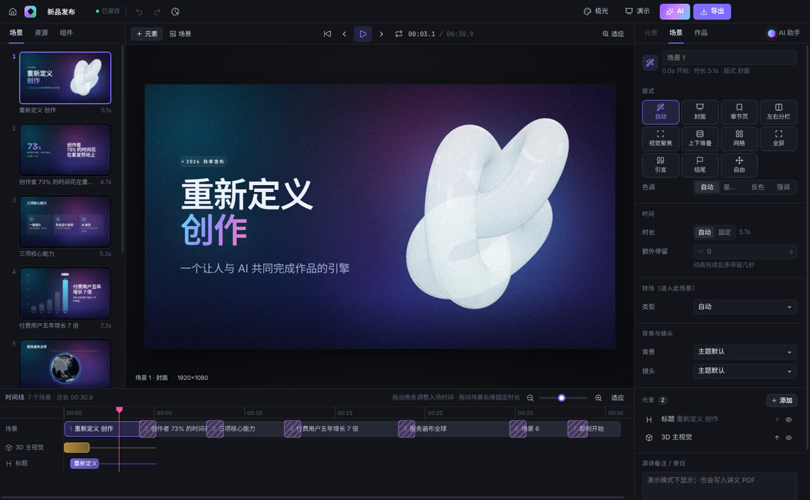
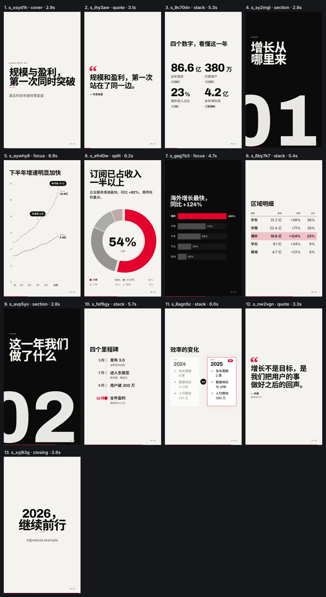
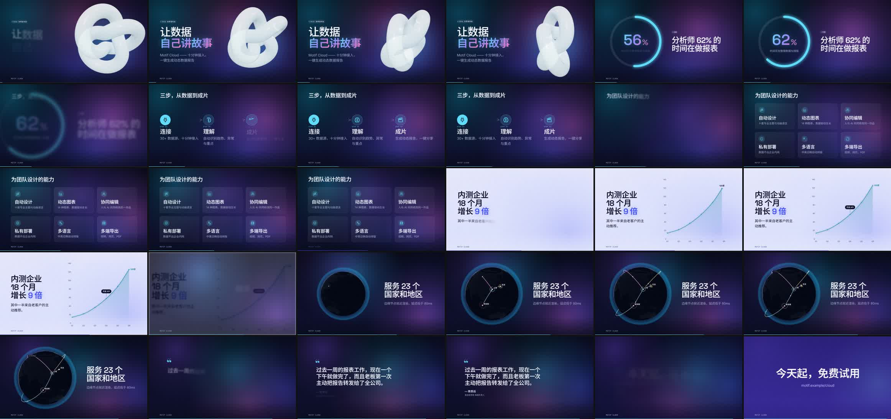
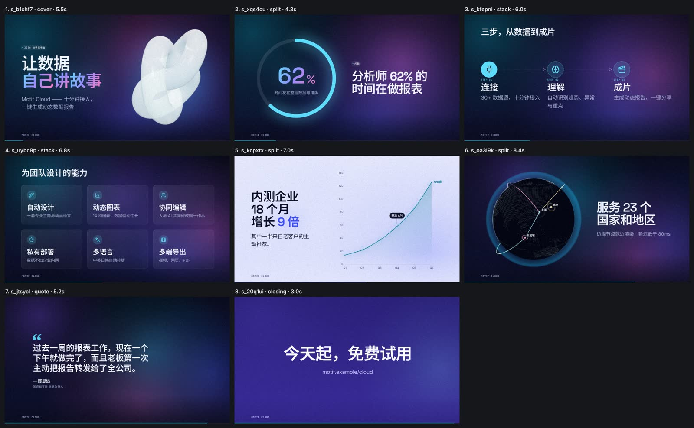
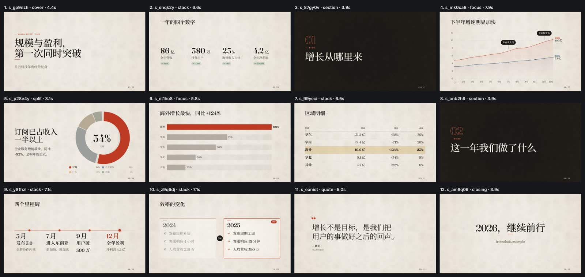
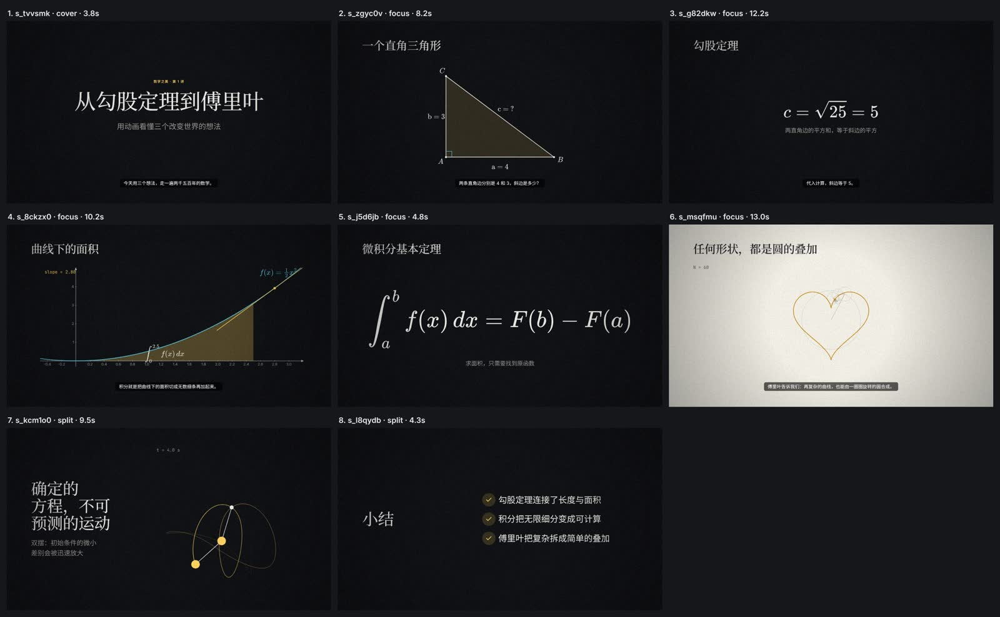
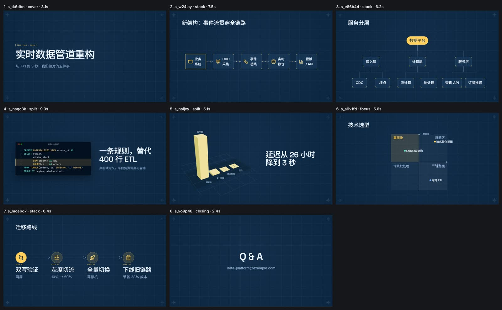

# 律影 Motif · 动态视觉创作软件

Motif 是一套可安装的 Windows 桌面软件，同时也是给 AI 用的工具。人可以在可视化编辑器里导入素材、编辑、选风格、做动画、预览和导出；Claude、DeepSeek、Qwen、Codex 等模型可以通过 **Skill / CLI / MCP** 创建和修改同一批作品。两边共用同一个项目系统、同一套设计组件和同一个渲染引擎：AI 做的作品人能接着改，人改过的作品 AI 也能读懂并继续做。



## 核心想法：AI 提供内容，软件完成设计

Motif 把专业动态设计的经验沉淀在软件本身，而不是写在提示词里：

- **10 套设计系统**（极光、报刊、瑞士、蓝图、数理、水墨、波普、商务、暗场、青野）。每套都有完整的配色与色调、字体角色、字号比例、网格、卡片、背景生成器、图表风格，以及独立的动画性格（缓动、节奏、入场方式、转场、镜头）。
- **38 种内容组件**：标题与正文、关键数字、14 种动态图表、表格、时间线、流程、层级、矩阵、对比、公式推导、函数图像、几何作图、线性变换、傅里叶、物理模拟、3D 地球、3D 柱状、曲面、粒子、分子、图片与视频等。
- **自动版式与编排**：根据内容选择版式（封面、分栏、聚焦、网格、全屏……），按主题的动画语言编排入场、节奏、转场与镜头。同一份内容切换 16:9 / 9:16 / 1:1 时会自动重排。
- **排版细节**：中文避头尾、标点处断行、数字与单位不拆行、平衡换行、自动缩放字号。
- **设计检查**：自动发现文字溢出、重叠、过密、对比度不足、节奏单调等问题，并给出修改建议。

所以 AI（或人）只需要给出内容、数据和少量设计意图，比如主题、画幅、节奏、要强调哪里。

| 同一份年报，换主题 + 竖屏后自动重排 | 动画过程（发布会示例，每 1.3 秒一帧） |
| --- | --- |
|  |  |

## 功能

**素材导入与自动设计**：支持 PPTX、DOCX、XLSX、PDF、Markdown、TXT、CSV、JSON 和图片。软件会识别章节、要点、表格（并建议图表类型）、关键数字、图片、公式与演讲备注，再自动设计成完整的动态作品。

**可视化编辑器**：
- 场景缩略图列表，可拖动排序；
- 画布上直接选中、拖动、缩放，带对齐吸附；
- 双击直接编辑文字；
- 检查器表单由组件目录自动生成，包括图表数据表格（可从 Excel 粘贴）、列表、图标、资源、颜色、动画和样式；
- 时间线：场景条与转场，每个元素的入场色条可拖动调整；
- 主题库会用你当前的场景实时渲染每一套主题；
- 实时预览、逐页演示模式、撤销/重做、版本历史（人与 AI 的修改都会记录）。

**导出**：MP4（H.264）、WebM、MOV ProRes、GIF、PNG 序列、PDF 讲义，以及可离线播放的单文件 HTML 交互演示。视频按帧精确渲染，多进程并行，会自动混入背景音乐与视频片段的声音。

**项目管理**：素材库默认位于 `文档/Motif`，保存作品、模板、可复用组件（块或整页）、自定义主题和资源。每次修改都会生成修订快照，可以命名版本、恢复历史；删除的作品进入回收站。

**内置 AI 助手**：可以接入自己的模型，包括 Claude、OpenAI、DeepSeek、通义千问、Kimi、智谱 GLM、OpenRouter，以及 Ollama、LM Studio 等本地模型。API Key 用系统加密存储保存在本机。助手通过与 CLI/MCP 相同的工具修改作品，改动会实时出现在编辑器里，并且可以撤销。

| 新建（模板实时预览） | 主题库（用当前场景渲染） | AI 助手 |
| --- | --- | --- |
|  |  |  |

## 给 AI 用：Skill / CLI / MCP

- **Skill**：`skill/motif/` 是完整的 Skill 包。`SKILL.md` 描述工作流（素材分析 → 建立项目 → 视觉设计 → 动画节奏 → 检查 → 导出）；`reference/` 是设计指南，以及由软件自动生成的组件、版式、主题、操作和 CLI 参考；`examples/` 有 5 个完整作品和 3 组编辑操作；`tools/` 有 OpenAI、Anthropic、MCP 三种格式的函数调用定义；`scripts/motif.mjs` 会自动找到本机安装的 Motif。在应用的「设置 → AI 集成」里可以一键安装到 Claude Code、Codex 或通用 Skill 目录。
- **CLI**：`motif <命令> --json`。常用命令有 `analyze`、`auto`、`new`、`show`、`apply`（原子编辑操作）、`write`、`lint`、`preview`、`still`、`export`、`templates`、`components`、`themes`、`history`、`catalog`。安装版自带 `motif.cmd`，并会加入用户 PATH，不需要另外安装 Node.js。
- **MCP**：运行 `motif mcp` 会启动 stdio MCP 服务器，提供 20 个工具；预览和截图类工具会直接返回图片。例如在 Claude Code 中：`claude mcp add motif -- motif mcp`。

```bash
motif analyze 年度汇报.pptx --json                  # 1. 分析素材
motif auto 年度汇报.pptx --theme editorial --json   # 2. 自动设计成作品
echo '[{"op":"set_format","aspect":"9:16"}]' | motif apply 年度汇报 - --agent claude
motif lint 年度汇报 && motif preview 年度汇报 --out sheet.jpg   # 3. 检查
motif export 年度汇报 --format mp4 --quality high   # 4. 导出
```

AI 的修改以「操作」（ops）的形式提交，整组要么全部生效、要么全部不生效，并带有校验和友好的错误提示。操作会在磁盘上的最新版本上重放，所以人在编辑器里和 AI 同时修改同一作品时，彼此的改动会合并，而不是互相覆盖。

## 示例作品

`examples/showcase/` 中的 5 个作品都可以直接导出为视频：

| 发布会（极光） | 年度报告（报刊） |
| --- | --- |
|  |  |
| **数学讲解（数理）** | **技术架构（蓝图）** |
|  |  |

## 安装与构建

**安装**：在 GitHub Actions 的「Motif · Windows build」里下载 `Motif-Setup-<版本>.exe`（安装版）或 `Motif-<版本>-x64-win.zip`（绿色版）。安装包内置 FFmpeg 和 Skill。从 0.10.0 起，手动运行该工作流并勾选 `release` 会发布到 Releases（`motif-v*`）；安装版会自己检查并安装新版本（设置 → 关于），绿色版不自动更新。签名与更新的做法见 [scripts/windows-release/](../scripts/windows-release/README.md)。

**开发**（需要 Node 22+）：

```bash
cd motif
npm ci
npm start                 # 构建并启动编辑器
node bin/motif.mjs help   # CLI
npm test                  # 单元测试（node:test）
npm run test:e2e          # 端到端：真实 Electron 窗口 + AI 助手（模拟模型）
npm run docs              # 从软件目录重新生成 Skill 参考文档
npm run dist:win          # 打包 Windows：NSIS 安装包 + 绿色版 zip
```

在 Linux 或 macOS 上，`npm run dist:win` 可以直接生成 Windows 绿色版（exe 的图标和版本信息用纯 JS 写入）；NSIS 安装包需要 Windows 或 wine，CI 会在 `windows-latest` 上构建，并对打包后的程序做冒烟测试。

架构说明见 [docs/ARCHITECTURE.md](docs/ARCHITECTURE.md)。
