# 音乐粒子宇宙 · Particle Universe

> 把一首歌变成一座由数百万颗粒子构成的宇宙——频谱、鼓点、节奏与能量实时驱动 GPU 粒子，配合电影级光影与自动运镜。

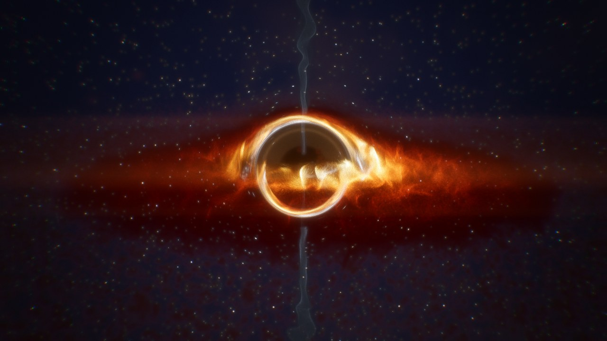

Windows 桌面程序（Electron 44 + WebGL2），完全本地运行：不需要服务器、账号或付费 API。

## 下载与运行

| 文件 | 说明 |
| --- | --- |
| `ParticleUniverse-Setup-<版本>-x64.exe` | Windows 10 / 11 64 位安装版，无需管理员权限。装好后会自己检查并安装新版本 |
| `ParticleUniverse-<版本>-win-x64-portable.zip` | 便携版，约 129 MB。解压后双击 `ParticleUniverse.exe`，无需安装；不会自动更新 |

获取方式：

1. **GitHub Actions**：仓库的 `particle-universe · Windows build` 工作流在 Windows 运行器上打包并运行端到端自检，产物名为 `ParticleUniverse-win-x64`；手动触发（`workflow_dispatch`）时还会发布 Release（`particle-universe-v*`），并刷新 `particle-universe-latest` 里的自动更新信息。
2. **本地构建**：见下文「从源码构建」，一条命令生成同样的 zip；安装版默认只在 Windows 上生成（NSIS 在其他系统上需要 Wine）。

> zip 超过 GitHub 单文件 100 MB 限制，因此不直接提交到仓库。默认未做代码签名：首次运行若出现 SmartScreen「未知发布者」提示，可点「更多信息 → 仍要运行」。设置 `WIN_CSC_LINK` 后工作流会给安装包签名，做法见 [scripts/windows-release/](../scripts/windows-release/README.md)。1.1.0 起为了自动更新加入了 NSIS 安装版（electron-builder 生成，没有加壳）；便携版 zip 保持不变。

系统要求：支持 DirectX 11 / WebGL2 的显卡（近十年的独显或核显）。笔记本双显卡会自动请求高性能显卡。

## 八个视觉场景

| | 场景 | 音乐如何驱动它 |
| --- | --- | --- |
| 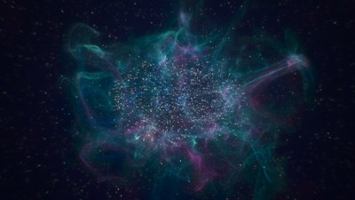 | **星云 Stellar Nebula** | 粒子凝聚在噪声等值面上形成丝状气体，被旋度噪声流场翻卷。低频让星云「呼吸」，鼓点激起球形冲击波，高频点亮星光 |
|  | **黑洞 Event Horizon** | 开普勒速度的吸积盘旋入视界；相对论多普勒增亮让朝向镜头的一侧更亮更蓝；屏幕空间引力透镜把盘的背面与星光弯折成光环；低频点燃双极喷流 |
| 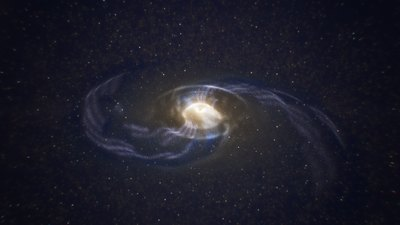 | **银河 Spiral Galaxy** | 密度波理论：层层旋转的椭圆轨道叠出旋臂，较差自转把恒星形成区剪切成羽状结构，并带有尘埃带。频谱从核心（低频）到外缘（高频）点亮星盘，鼓点激起涟漪 |
| 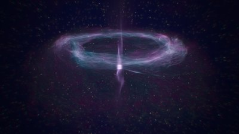 | **能量风暴 Plasma Storm** | 等离子环面：粒子绕环高速运动并在环管内环流，高频撕裂湍流，军鼓劈出闪电扇区，鼓点引爆冲击环，中心光柱随低频喷射 |
| 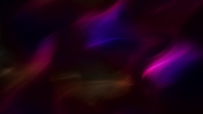 | **流体丝绸 Liquid Silk** | 二维无散度流场 + 四个频段涡旋；粒子沿流线拉成拖影，各向异性的「缎面高光」随纤维方向闪烁 |
| 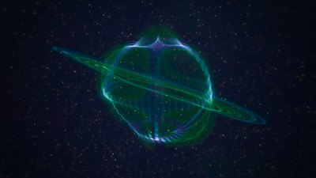 | **共振星球 Cymatic Planet** | 由音乐和声（色度 chroma）选择球面驻波模式，节点线像克拉尼图形一样发光；星环随鼓点荡漾 |
|  | **超空间跃迁 Hyperspace** | 第一人称穿越光之隧道：能量决定航速，高潮触发跃迁，隧道壁沿圆周映射频谱起伏 |
| 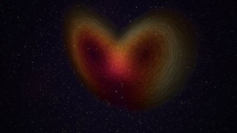 | **奇异吸引子 Strange Attractor** | 每颗粒子积分 Lorenz / Aizawa / Thomas / Halvorsen / Dadras / Chen 混沌方程；鼓点把粒子打散、方程再把它们收拢；新段落与高潮切换方程 |

场景之间不是硬切：粒子会沿旋度噪声的弯曲路径飞向下一个场景的形态，色板、光效与背景同步过渡。

## 音乐理解

导入的音频先在 Worker 中完整分析一遍（约每分钟 1 秒），播放与导出都使用同一份结果，因此画面与声音逐帧对齐：

- **频谱**：4096 点 FFT，每秒 100 帧，128 个对数频带；按整首曲目的分位数逐频带归一化，安静与吵闹的歌都能驱动满幅度画面。
- **六个能量段**（超低频 / 低频 / 中低 / 中 / 中高 / 高频）、响度、频谱质心、12 音级色度。
- **起音检测**：1024 点谱通量 + 自适应阈值，分别得到底鼓、军鼓/人声、镲片三类事件与包络。
- **节拍网格**：自相关估计速度 + Ellis 动态规划节拍跟踪；用「底鼓+军鼓−镲片」显著性判断正拍相位，再用和声与低频变化推断小节线。
- **段落与高潮**：小节级特征的新颖度给出段落边界；低频（30–110 Hz）持续上跳并伴随鼓点的位置判为高潮（drop），并生成高潮前的蓄力曲线。

内置的演示曲《极光 Aurora》是用 Web Audio 程序化合成的 124 BPM 电子乐。合成一遍在快的电脑上也要二三十秒，没有显卡时要好几分钟，所以合成结果预先保存成 `src/renderer/assets/demo-aurora.ogg`（Opus，约 2.6 MB，由 `node scripts/make-demo-audio.mjs` 生成，需要 ffmpeg），打开时直接解码；文件缺失时才现场合成。分析结果可与乐谱核对：速度 123.9 BPM、第一个小节线 0.00 s、两处高潮分别检出于第 20 小节（误差 10 ms）和第 48 小节。

另外可以直接**捕获系统声音**（Windows 回环录音）或麦克风，实时可视化任何播放器正在播放的音乐，此时使用因果的在线分析器。

## 渲染管线

- **GPU 粒子模拟**：位置 / 速度 / 场景数据存放在 RGBA32F 纹理中，片元着色器以 MRT 一次写出三张纹理；13 万到 419 万颗粒子（512² – 2048²）。
- **绘制**：顶点拉取、批量索引四边形；粒子按屏幕速度拉伸成运动模糊拖影，按能量守恒处理亚像素与景深虚化（散景大小随焦距变化）。
- **HDR 后期**：半精度浮点缓冲 → 黑洞引力透镜（前后分层渲染，背景与盘背面被弯折）→ 帧间余辉拖尾 → 程序化星空与星云背景 → 物理泛光（13 tap 降采样 + 帐篷滤波升采样）→ 变形宽银幕光晕 → 色散、ACES 胶片色调映射、调色、暗角、胶片颗粒与抖动。
- **自动运镜**：每个场景都有一组镜头（环绕、推拉、升降、螺旋、穿越、第一人称）。导演按小节决定镜头时长，在小节线上平滑过渡或在强拍上硬切；高潮触发硬切与闪光，蓄力段缓慢推近，鼓点带来视角冲击与低频震动。拖动鼠标即可接管为自由镜头，按 C 交还。
- **自适应画质**：根据显卡型号选择初始粒子数，启动后用短暂的压力测试校准；运行中依据帧时间（若可用则用 GPU 计时查询）先调整内部渲染分辨率，再增减粒子数。粒子数变化时现有粒子会被重新采样并平滑过渡，不会跳变。

## 视频导出

底栏胶片图标或按 `X`。导出是**离线逐帧渲染**：每一帧都以固定时间步长从分析结果驱动模拟，并在目标分辨率下渲染，所以即便显卡跑不满实时帧率，导出的视频依然流畅、与音乐严格同步。

- 分辨率：720p、1080p、2K、4K、竖屏 1080×1920、方形 1440×1440；30 / 60 fps；三档码率。
- 格式：MP4（H.264，AAC 或 Opus）或 WebM（VP9 + Opus），使用 WebCodecs，Windows 上优先硬件编码。
- 可导出整首、从当前位置或自定义区间；可选用比实时更多的粒子；视频流式写入磁盘，长视频不占内存。

## 操作

| 按键 | 功能 | 按键 | 功能 |
| --- | --- | --- | --- |
| `Space` | 播放 / 暂停 | `1`–`8` | 切换场景 |
| `←` `→` | 快退 / 快进 5 秒 | `N` | 下一个场景 |
| `↑` `↓` | 音量 | `C` | 自动运镜 / 自由镜头 |
| `[` `]` | 上一首 / 下一首 | `R` | 重置镜头 |
| `F` / `F11` / 双击 | 全屏沉浸 | `W A S D Q E` | 自由镜头旋转、缩放 |
| `H` | 隐藏界面 | `K` | 截图（保存到「图片\音乐粒子宇宙」） |
| `L` | 播放列表 | `Tab` | 参数面板 |
| `G` | 场景面板 | `X` | 导出视频 |
| `M` | 静音 | `I` | 性能信息 |

播放时鼠标静止 3 秒界面自动隐去，进入沉浸模式。参数面板包含粒子（数量、大小、亮度、速度、湍流、拖影、过渡时长与每个场景的专属参数）、音频（灵敏度、低频冲击、高频闪烁、节拍冲击波、音画同步偏移）、光影（泛光、光晕、余辉、景深、色散、颗粒、暗角、星空、2.39:1 宽银幕）、色彩（12 套色板、色相、饱和度、对比度、色温）、镜头（运镜风格、震动、自动切换场景）与画质。所有设置自动保存。

| 欢迎界面 | 参数面板 | 场景选择 | 导出 |
| --- | --- | --- | --- |
| 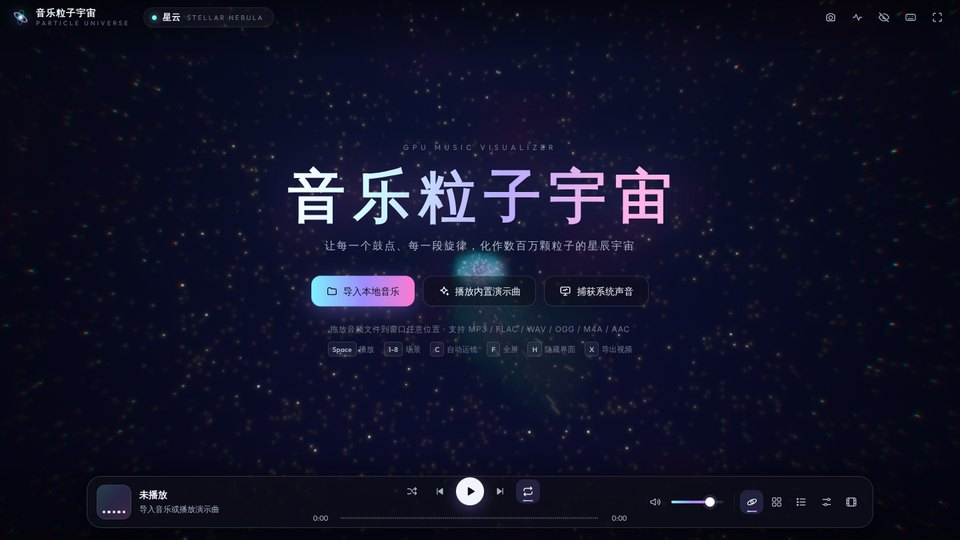 | 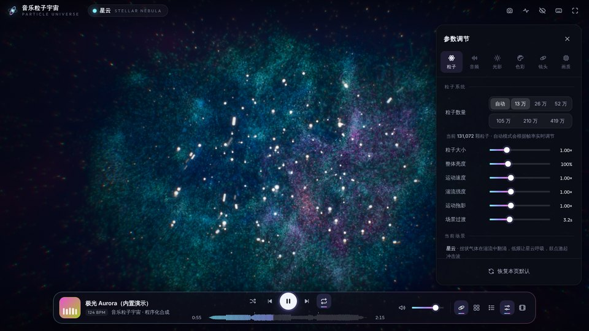 | 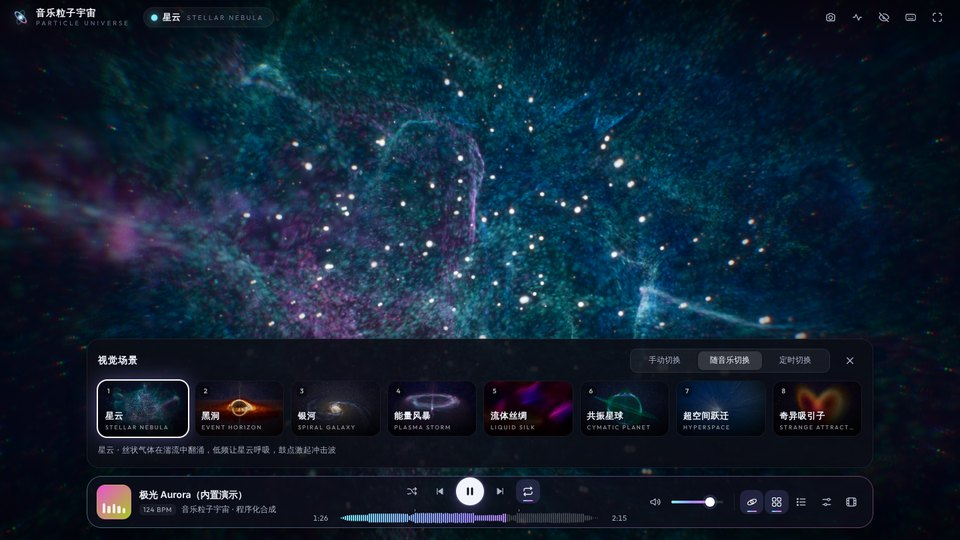 | 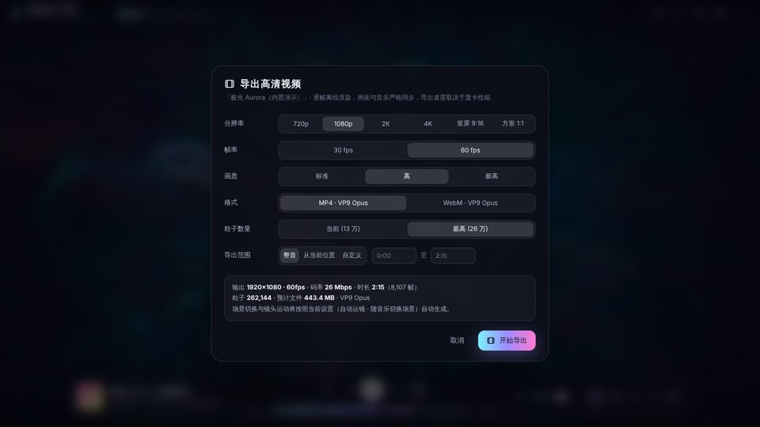 |

## 从源码构建

需要 Node.js 22。

```sh
cd particle-universe
npm ci
npm start            # 构建并启动 Electron
npm run dev          # 仅在浏览器中开发渲染端（Chrome / Edge）
npm run dist:win     # 生成 release/ParticleUniverse-<版本>-win-x64-portable.zip
```

`dist:win` 在 Linux / macOS / Windows 上都可运行，不需要 Wine：electron-builder 生成 `win-unpacked`，脚本用 resedit 写入图标与版本信息，再打包为 zip。若 `~/.cache/electron/` 中已有对应版本的 Windows Electron 压缩包会直接使用，否则由 electron-builder 下载。

## 测试

| 命令 | 内容 |
| --- | --- |
| `electron . --smoke` | 端到端自检：合成演示曲 → 分析 → 依次运行 8 个场景并记录帧率 → 导出 6 秒 720p MP4，结果写入 JSON 后退出（CI 中对打包后的 exe 运行） |
| `node tests/analysis-test.mjs` | 演示曲分析精度：速度、小节线、高潮、段落、底鼓时间误差 |
| `node tests/web-smoke.mjs` | 用 Playwright 驱动真实界面并截图 |
| `node tests/engine-shots.mjs` / `hq-shots.mjs` | 逐场景离屏渲染，用于画面调校 |

已完成的验证：

- **Windows（打包后的 exe）**：GitHub Actions `windows-latest`，显卡为 Microsoft Basic Render Driver（Direct3D 11 软件适配器，无独立 GPU）。自检全部通过：演示曲分析结果与 Linux 一致（123.9 BPM、高潮 38.72 s / 92.91 s），8 个场景依次运行，导出 1280×720 / 30 fps H.264 MP4（180 帧，3.75 MB）。该环境的 WebCodecs 未提供 AAC 编码，因此 MP4 音轨自动改用 Opus。
- **Linux**：Electron 44 + SwiftShader，源码运行与打包（asar）后运行两种方式的自检均通过；另用同一导出流程渲染了 21.5 秒、105 万粒子的 720p 片段。
- 软件渲染只用来验证功能，帧率（约 11 fps / 13 万粒子）不代表真实显卡上的表现。

## 目录

```
src/main/            Electron 主进程（app:// 安全协议、文件与对话框 IPC、系统声音回环、单实例）
src/renderer/
  audio/             FFT、离线分析 Worker、实时分析、播放引擎、演示曲合成
  gfx/               WebGL2 工具、粒子系统、后期、调色板、引擎、自适应画质
  scenes/            8 个场景（GLSL 模拟 / 生成 / 着色 + 镜头与光效预设）
  camera/            相机、自由镜头、自动运镜导演
  core/              应用控制、设置、播放列表、标签读取、场景调度、平台适配、自检
  export/            WebCodecs 编码与 MP4 / WebM 封装
  ui/                界面
scripts/             图标生成、Windows 打包
tests/               分析、界面与渲染测试
```

## 已知限制

- 本程序需要 WebGL2 与浮点渲染目标；极老的显卡或远程桌面中的基础显示适配器会退回软件渲染，帧率很低。
- 单首曲目最长 90 分钟（整首解码进内存后再分析）。
- 视频编码依赖系统提供的 WebCodecs 编码器；若某个分辨率下没有可用的 H.264 编码器，导出对话框会自动提供 WebM (VP9)。系统缺少 AAC 编码器时（如 Windows N 版、Windows Server），MP4 的音轨改用 Opus，个别老旧播放器可能无法播放其声音。
- 「捕获系统声音」使用 Windows 的回环录音；在 macOS / Linux 上只能使用麦克风输入。
- 未签名的 Electron 程序可能被个别杀毒软件的机器学习规则误报；源码与构建脚本均在本目录，可自行构建核对。
