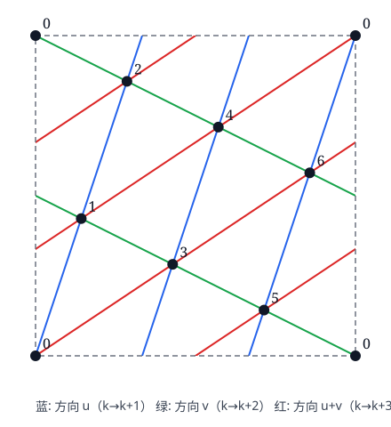

# 2027 新领军一试预测训练卷 · 参考答案与详解

**说明**　本卷为按 2027 年新考纲编写的模拟训练卷，答案与“评分要点”均为本卷建议标准，不是官方评分细则。每题先列答案，再给完整解答；“评分要点”列出阅卷时应看到的关键步骤。

## 答案速查

| 题号 | 答案 |
| :---: | :--- |
| 1 | (1) $r(P)=\dfrac ba\sqrt{a^2\sin^2t+b^2\cos^2t}$；(2) 见证明；(3) $P=(\pm a,0)$ |
| 2 | (1) 见证明；(2) 等号例：四元数群 $Q_8$ 或 8 阶二面体群 $D_4$；(3) 最大值 $\dfrac{11}{27}$（$\mathbb F_3$ 上 $3\times3$ 上三角幺幂矩阵群取到） |
| 3 | (1) 见证明；(2) 顶点取 $P_k=(\{k/7\},\{3k/7\})$，$k=0,\dots,6$，连三族线段，见详解 |
| 4 | (1) $V_n=\dfrac{1}{4\sin^2\frac{\pi}{4n+2}}$；(2) $\dfrac{4}{\pi^2}$ |
| 5 | (1) $4$；(2) $-4$ |
| 6 | (1) $I(f)=\dfrac{2\pi}3$，$T_N(f)=\dfrac{2\pi}{3}\cdot\dfrac{2^N+1}{2^N-1}$；(2) 全体 $N\ge3$ |
| 7 | (1) 见证明；(2) $x_0=t\,(M,\pm m)$，$t\ne0$ |
| 8 | (1) $\hat N=M$，有偏（$n<N$ 时低估）；(2) $a_n=\dfrac{n+1}{n}$，$b_n=-1$；(3) $\dfrac{n+2}{3}$ |
| 9 | (1) 见证明；(2) 不一定成立，有反例；(3) $p=\dfrac5{64}\approx0.078$，不拒绝 |
| 10 | (1) $T=2\pi\sqrt{\dfrac{mV_0}{\gamma\,(p_0+mg/A)\,A^2}}$；(2) $\gamma\approx1.65$，单原子分子；(3) 声波穿过瓶子约 $10^{-3}$ s、热扩散约 $10^3$ s，周期 $\sim1$ s 夹在中间；(4) 等温模型应得 $T\approx1.25$ s，与实测 $0.975$ s 矛盾；壁面换热使算出的 $\gamma$ 偏小 |
| 11 | (1) $v_1=\dfrac{mv_0}{m+B^2L^2C}$，$Q=\dfrac{B^2L^2C}{m+B^2L^2C}\cdot\dfrac12mv_0^2$，与 $R$ 无关；(2) $v=v_1+(v_0-v_1)e^{-t/\tau}$，$\tau=\dfrac{mRC}{m+B^2L^2C}$；(3) $v_2=\dfrac{BLCU_0}{m+B^2L^2C}$，$\eta_{\max}=\dfrac14$，条件 $B^2L^2C=m$ |
| 12 | (1) $U_c=0.414\,\nu-2.003$（$\nu$ 以 $10^{14}$ Hz 计），$h\approx6.62\times10^{-34}$ J·s，$W\approx2.00$ eV，$\nu_0\approx4.84\times10^{14}$ Hz；(2) $h$ 不受影响，$W$ 偏差 $-e\Delta U$；(3) $\operatorname{Var}(\hat k)=\sigma^2/\sum(\nu_i-\bar\nu)^2$，两端各取 $n$ 个 |

<!-- pagebreak -->

## 第 1 题

**答案**　(1) $r(P)=\dfrac ba\,S(t)$，其中 $S(t)=\sqrt{a^2\sin^2t+b^2\cos^2t}$；(2) 见证明；(3) $P=(\pm a,0)$。

记 $c^2=a^2-b^2$。

**第一步：合格圆盘必在 $P$ 处与 $E$ 相切。** $K$ 是凸集，$E$ 在 $P$ 处的切线 $\ell$ 是 $K$ 的支撑线，$K$ 落在 $\ell$ 一侧的闭半平面 $H$ 内。设闭圆盘 $D\subseteq K$，$P$ 在 $D$ 的边界圆上。若 $\ell$ 不是该圆在 $P$ 处的切线，则 $\ell$ 穿过 $D$ 的内部，$D$ 的内部就含有 $\ell$ 两侧的点，与 $D\subseteq H$ 矛盾。所以圆心在 $P$ 处的内法线上。外法向与梯度 $\bigl(\tfrac{x}{a^2},\tfrac{y}{b^2}\bigr)$ 同向，即与 $(b\cos t,\ a\sin t)$ 同向，因此半径为 $r$ 的合格圆盘的圆心只能是
$$
O_r=P-\frac{r}{S(t)}\,(b\cos t,\ a\sin t),\qquad S(t)=\bigl|(b\cos t,\ a\sin t)\bigr|.
$$

**第二步：候选圆心。** $O_r$ 的纵坐标为 $\sin t\,\bigl(b-\tfrac{ra}{S}\bigr)$。取 $r_0=\dfrac{bS}{a}$，圆心落在长轴上：
$$
O^*=\Bigl(a\cos t-\frac{b^2}{a}\cos t,\ 0\Bigr)=\Bigl(\frac{c^2}{a}\cos t,\ 0\Bigr).
$$

**第三步：以 $O^*$ 为心、$r_0$ 为半径的闭圆盘 $D^*$ 含于 $K$。** 记 $x_0=\frac{c^2}{a}\cos t$。对 $E$ 上任一点 $Q=(a\cos s,b\sin s)$，令 $u=\cos s\in[-1,1]$，
$$
|QO^*|^2=(au-x_0)^2+b^2(1-u^2)=c^2u^2-2ax_0u+x_0^2+b^2=c^2(u-\cos t)^2+\text{常数}.
$$
它在 $u=\cos t$（即 $Q=P$ 或 $P$ 关于 $x$ 轴的对称点）处取最小值 $|PO^*|^2=r_0^2$。所以 $E$ 上每点到 $O^*$ 的距离都 $\ge r_0$。又 $|x_0|<a$，$O^*$ 在 $K$ 内部；开圆盘 $B(O^*,r_0)$ 连通、含 $O^*$ 且与 $E=\partial K$ 不交，故含于 $K$ 的内部，于是 $D^*\subseteq K$，$r(P)\ge r_0$。

**第四步：不能更大。** 设合格圆盘半径 $r>r_0$，由第一步圆心为 $O_r$。

- 若 $\sin t\ne0$：$O_r$ 的纵坐标 $y_O=\sin t\,(b-ra/S)$ 与 $P$ 的纵坐标 $b\sin t$ 异号。取 $E$ 上的点 $P'=(a\cos t,-b\sin t)\ne P$，
$$
|O_rP'|^2-|O_rP|^2=(y_O+b\sin t)^2-(y_O-b\sin t)^2=4\,y_O\,b\sin t<0,
$$
即 $P'$ 在圆盘的内部。但 $P'\in\partial K$，它附近有 $K$ 外的点也在圆盘内，矛盾。
- 若 $\sin t=0$，不妨 $P=(a,0)$，圆心 $(a-r,0)$。对 $Q=(a\cos s,b\sin s)$，$u=\cos s$，
$$
\varphi(u)=|QO_r|^2=c^2u^2-2a(a-r)u+(a-r)^2+b^2,\qquad \varphi(1)=r^2,\quad \varphi'(1)=2(ar-b^2).
$$
当 $r>b^2/a=r_0$ 时 $\varphi'(1)>0$，于是 $u$ 略小于 $1$ 时 $\varphi(u)<r^2$，$E$ 上有点落在圆盘内部，矛盾。$P=(-a,0)$ 同理。

所以 $r(P)=r_0=\dfrac ba\sqrt{a^2\sin^2t+b^2\cos^2t}$。它在长轴端点取最小值 $b^2/a$，在短轴端点取最大值 $b$。

**(2)** 设 $D\subseteq K_C$ 是半径为 $r>0$ 的闭圆盘，$P$ 在其边界圆上。凸集 $K_C$ 在边界点 $P$ 处有支撑线；它必是 $C$ 在 $P$ 处的切线 $\ell$，否则正则曲线 $C$ 经过 $P$ 时会穿到这条支撑线的两侧。于是与 (1) 第一步相同，圆在 $P$ 处与 $\ell$ 相切，圆心在内法线上。

取坐标使 $P$ 为原点、$\ell$ 为 $x$ 轴、圆心为 $(0,r)$，$K_C$ 落在 $y\ge0$ 一侧。$C$ 二阶连续可微且在 $P$ 处切线水平，所以可取足够小的矩形 $U=(-\delta,\delta)\times(-\eta,\eta)$，使 $C\cap U$ 恰好是函数 $y=h(x)$ 的图像（$C$ 是简单闭曲线，其余弧段与 $P$ 的距离为正），$h$ 二阶连续可微，$h(0)=h'(0)=0$，$h\ge0$。$U$ 中位于图像下方的部分连通、含有点 $(0,-\varepsilon)\notin K_C$、且不与 $C=\partial K_C$ 相交，所以整个在 $K_C$ 之外；因此 $U$ 中属于 $K_C$ 的点都满足 $y\ge h(x)$。

圆的下半弧上的点 $\bigl(x,\ r-\sqrt{r^2-x^2}\bigr)$ 属于 $D\subseteq K_C$，$|x|$ 很小时落在 $U$ 中，于是
$$
r-\sqrt{r^2-x^2}\ \ge\ h(x).
$$
两边除以 $x^2$ 并令 $x\to0$：左边 $\to\dfrac1{2r}$；由泰勒公式，右边 $\to\dfrac{h''(0)}2$。又 $h'(0)=0$ 时曲率 $\kappa=\dfrac{|h''(0)|}{(1+h'(0)^2)^{3/2}}=h''(0)$，所以 $\dfrac1{r}\ge\kappa$，即 $r\le\rho_C(P)$。对所有合格圆盘取上确界，得 $r_C(P)\le\rho_C(P)$。

**(3)** 对 $\gamma(t)=(a\cos t,b\sin t)$，
$$
\kappa=\frac{|x'y''-x''y'|}{(x'^2+y'^2)^{3/2}}=\frac{ab}{S^3},\qquad \rho_E=\frac{S^3}{ab}.
$$
于是
$$
\frac{r(P)}{\rho_E(P)}=\frac{bS/a}{S^3/(ab)}=\frac{b^2}{S^2}=\frac{b^2}{b^2+c^2\sin^2t},
$$
等于 $1$ 当且仅当 $\sin t=0$，即 $P=(\pm a,0)$。（这也对椭圆独立验证了 (2)。）

**评注**　短轴端点处 $r=b$，而 $\rho_E=a^2/b>b$：曲率半径只给出“局部”上界，真正卡住圆盘的是对称点 $P'$ 这一“整体”障碍；只有在长轴端点，两种障碍才重合。另外 $a^2-c^2\cos^2t=|PF_1|\cdot|PF_2|$（$F_1,F_2$ 为焦点），所以 $r(P)=\dfrac ba\sqrt{|PF_1|\,|PF_2|}$。

**评分要点**　圆心必在内法线上（相切论证）；找到法线与长轴交点并验证 $D^*\subseteq K$；对 $r>r_0$ 用对称点或一维二次函数排除；(2) 把曲线局部写成函数图像，用圆弧与图像作二阶比较；(3) 曲率公式与比值化简。

---

## 第 2 题

**答案**　(2) 等号例 $Q_8$ 或 $D_4$；(3) 最大值 $\dfrac{11}{27}$。

**(1)** 对 $x\in G$，记 $C(x)$ 为中心化子，$\mathrm{cl}(x)$ 为共轭类。满足 $xy=yx$ 的有序对个数为 $\sum_{x}|C(x)|$。$G$ 以共轭作用于自身，$x$ 的轨道为 $\mathrm{cl}(x)$、稳定子为 $C(x)$，由轨道–稳定子公式 $|C(x)|=|G|/|\mathrm{cl}(x)|$。于是
$$
\sum_{x\in G}|C(x)|=|G|\sum_{\text{共轭类 }\mathcal K}\ \sum_{x\in\mathcal K}\frac{1}{|\mathcal K|}=|G|\cdot k(G),
$$
除以 $|G|^2$ 得 $P(G)=k(G)/|G|$。

**(2)** 记 $Z=Z(G)$ 为中心。

*引理*：若 $G/Z$ 是循环群，则 $G$ 交换。设 $G/Z=\langle gZ\rangle$，则每个元素可写成 $g^iz$（$z\in Z$），任意两个这样的元素可交换。

$G$ 不交换时，$G/Z$ 不是循环群，所以 $|G/Z|\ne1$，且 $|G/Z|$ 不是素数（素数阶群都是循环群），故 $|G/Z|\ge4$。$Z$ 中每个元素自成一个共轭类，其余共轭类大小 $\ge2$，所以
$$
k(G)\le|Z|+\frac{|G|-|Z|}{2},\qquad P(G)\le\frac{1+z}{2},\quad z=\frac{|Z|}{|G|}\le\frac14,
$$
即 $P(G)\le\dfrac58$。

等号例：$Q_8=\{\pm1,\pm i,\pm j,\pm k\}$ 的共轭类为 $\{1\},\{-1\},\{\pm i\},\{\pm j\},\{\pm k\}$，$k=5$，$P=5/8$。8 阶二面体群 $D_4$ 同样取等。

**(3)** 设 $G$ 为奇数阶非交换群。共轭类大小 $|G|/|C(x)|$ 整除 $|G|$，都是奇数，所以非中心的共轭类大小 $\ge3$。$|G/Z|$ 整除 $|G|$，为奇数；$G/Z$ 不循环，所以 $|G/Z|$ 不是 $1$、不是素数，是奇合数，$|G/Z|\ge9$。于是
$$
k(G)\le|Z|+\frac{|G|-|Z|}{3},\qquad P(G)\le\frac{1+2z}{3}\le\frac{1+2/9}{3}=\frac{11}{27}.
$$

**取到 $11/27$ 的例子**：$\mathbb F_3$ 上的海森堡群
$$
H=\left\{\begin{pmatrix}1&a&c\\0&1&b\\0&0&1\end{pmatrix}:a,b,c\in\mathbb F_3\right\},\qquad |H|=27.
$$
记该矩阵为 $(a,b,c)$，则 $(a,b,c)(a',b',c')=(a+a',\,b+b',\,c+c'+ab')$，两元可交换当且仅当 $ab'=a'b$。中心为 $\{a=b=0\}$，阶为 3。对 $x=(a,b,c)$，$(a,b)\ne(0,0)$，条件 $ab'=a'b$ 是关于 $(a',b')$ 的一个非平凡线性方程，有 3 组解，$c'$ 任取，$|C(x)|=9$，共轭类大小为 3。故 $k(H)=3+24/3=11$，$P(H)=11/27$。所求最大值为 $\dfrac{11}{27}$。

**评注**　(3) 不能照搬 (2) 的数字：奇数阶把两处下界同时抬高（非中心类 $\ge3$，$|G/Z|\ge9$）。另一种 27 阶非交换群 $\mathbb Z_9\rtimes\mathbb Z_3$ 也取到 $11/27$。

**评分要点**　交换对计数化为 $\sum|C(x)|$ 并用轨道–稳定子；$G/Z$ 循环 $\Rightarrow$ 交换；$|G/Z|\ge4$ 与类大小 $\ge2$ 的结合；奇数阶时两处下界的改进；构造取等的群并验证。

---

## 第 3 题

**(1)** 只需证明：**每个可嵌入 $\mathbb T$ 的有限简单图都有度数 $\le6$ 的顶点。** 有了它，对顶点数归纳：顶点数 $\le7$ 时直接用不同颜色；否则取度数 $\le6$ 的顶点 $v$，$\Gamma-v$（抹去 $v$ 及其关联边）仍可嵌入 $\mathbb T$，由归纳假设可 7 染色，$v$ 至多有 6 个邻点，留给 $v$ 一种未用颜色即可。

证明度数界：取 $\Gamma$ 的一个连通分支 $\Gamma_0$（它单独嵌入 $\mathbb T$），设其有 $V_0$ 个顶点、$E_0$ 条边，把 $\mathbb T$ 分成 $F$ 个区域。只需证明 $E_0\le3V_0$：这样 $\Gamma_0$ 的平均度数 $2E_0/V_0\le6$，必有度数 $\le6$ 的顶点。

- 若 $\Gamma_0$ 是树，$E_0=V_0-1\le3V_0$。
- 否则 $\Gamma_0$ 含圈。先说明**每个区域 $f$ 的边界都含有 $\Gamma_0$ 的一个圈**。$f$ 的边界由若干整条边和顶点组成，记为子图 $H$。若 $H$ 不含圈（是森林），则 $\mathbb T\setminus H$ 连通（每棵树有一个圆盘状的小邻域，圆盘去掉其中的树仍连通且与圆盘边界相连，而环面挖去若干个互不相交的小圆盘仍连通）。$f$ 在 $\mathbb T\setminus H$ 中既开又闭（它的边界都在 $H$ 里），所以 $f=\mathbb T\setminus H$，从而 $\Gamma_0\subseteq H$，与 $\Gamma_0$ 含圈矛盾。简单图的圈至少有 3 条边，所以每个区域的边界至少含 3 条边；而每条边至多出现在 2 个区域的边界上。对“（区域，其边界上的边）”双重计数，得
$$
3F\le2E_0 .
$$
代入 $V_0-E_0+F\ge0$：$V_0-E_0+\tfrac23E_0\ge0$，即 $E_0\le3V_0$。

（阅卷时，考生按平面图的通常做法写“每个区域至少由 3 条边围成，每条边至多与两个区域相邻”，并对树的情形另作说明，可视为完整。）

**(2)** 构造。令
$$
u=\Bigl(\tfrac17,\tfrac37\Bigr),\quad v=\Bigl(\tfrac27,-\tfrac17\Bigr),\quad w=u+v=\Bigl(\tfrac37,\tfrac27\Bigr),\qquad P_k=\Bigl(\Bigl\{\tfrac k7\Bigr\},\Bigl\{\tfrac{3k}7\Bigr\}\Bigr)\ (k=0,1,\dots,6),
$$
$\{\cdot\}$ 表示小数部分。在平面上，令 $\Lambda=\{iu+jv:i,j\in\mathbb Z\}$。

- $u+3v=(1,0)$，$2u-v=(0,1)$，所以 $\mathbb Z^2\subseteq\Lambda$；$\det(u,v)=-\tfrac17$，故 $[\Lambda:\mathbb Z^2]=7$。$\Lambda$ 中的点模 $\mathbb Z^2$ 恰为 $P_0,\dots,P_6$，且 $iu+jv\equiv P_{i+2j\bmod 7}$（因为 $v\equiv2u$）。
- 平面上以 $\Lambda$ 为顶点、以三族线段 $[p,p+u]$、$[p,p+v]$、$[p,p+w]$（$p\in\Lambda$）为边，构成平面的三角剖分：它是“每个单位正方形沿对角线切开”的标准剖分在线性变换 $(1,0)\mapsto u,\ (0,1)\mapsto v$ 下的像，三角形为 $\{p,p+u,p+w\}$ 与 $\{p,p+v,p+w\}$，各线段除端点外不交。
- 这个剖分在 $\Lambda$ 的平移下不变，特别在 $\mathbb Z^2$ 的平移下不变，所以它投影到 $\mathbb T=\mathbb R^2/\mathbb Z^2$ 上。每条线段上没有两个不同点相差整向量（例如 $s u\in\mathbb Z^2$ 只在 $s\in7\mathbb Z$ 时成立，$v,w$ 同理），所以每条边投影成 $\mathbb T$ 上的简单曲线；两条投影边若有不是公共端点的交点，提升到平面就是两条在非公共端点处相交的剖分边，只能是同一条边的平移，因此投影后是同一条边。故投影后各边只在端点相交；又平面剖分中顶点不在其他边的内部，所以投影后边的内部也不经过顶点。
- 投影后，$P_k$ 沿 $u,v,w$ 方向分别连到 $P_{k+1},P_{k+2},P_{k+3}$（下标模 7）。边集为 $\{P_kP_{k+d}:k\in\mathbb Z_7,\ d=1,2,3\}$，共 21 条；对任意 $i\ne j$，$j-i$ 与 $i-j$ 中恰有一个模 7 落在 $\{1,2,3\}$，所以 21 条边恰好是全部 $\binom72=21$ 个顶点对。

因此 $K_7$ 嵌入了 $\mathbb T$。（附带地，14 个三角形给出 $V-E+F=7-21+14=0$。）

**评注**　(1)(2) 合起来说明：环面上的地图恰好需要 7 种颜色（Heawood）。构造的关键是把 $K_7$ 看成平面三角格点模一个指数为 7 的子格：每个格点有 6 个邻点 $\pm u,\pm v,\pm w$，模 7 恰好对应 $\pm1,\pm2,\pm3$，即 $\mathbb Z_7$ 的全部非零元。

**评分要点**　每个区域的边界至少含 3 条边（树的情形单列）；$E\le3V$ 推出最小度 $\le6$；子图仍可嵌入、归纳染色；给出明确的嵌入并说明无交叉、恰好得到全部 21 条边。

---

## 第 4 题

**答案**　(1) $V_n=\dfrac{1}{4\sin^2\dfrac{\pi}{4n+2}}$；(2) $\dfrac4{\pi^2}$。

**(1)** **把加权和改写成独立变量之和。** 令 $b_j=a_j+a_{j+1}+\cdots+a_n$（$1\le j\le n$），$b_{n+1}=0$。交换求和次序：
$$
\sum_{k=1}^na_kS_k=\sum_{k=1}^na_k\sum_{j\le k}X_j=\sum_{j=1}^nX_j\sum_{k\ge j}a_k=\sum_{j=1}^nb_jX_j .
$$
$X_j$ 独立、方差为 1，故 $\operatorname{Var}=\sum_jb_j^2$。而 $a_j=b_j-b_{j+1}$，$a\mapsto b$ 是可逆线性变换，所以
$$
V_n=\max_{b\ne0}\frac{\sum_{j=1}^nb_j^2}{q(b)},\qquad q(b)=\sum_{j=1}^{n}(b_j-b_{j+1})^2\quad(b_{n+1}=0).
$$
$q$ 是正定二次型，矩阵为三对角阵
$$
Q=\begin{pmatrix}1&-1&&&\\-1&2&-1&&\\&\ddots&\ddots&\ddots&\\&&-1&2&-1\\&&&-1&2\end{pmatrix},
$$
由谱定理 $V_n=1/\lambda_{\min}(Q)$。

**求 $Q$ 的全部特征值。** 试 $b_j=\cos\bigl((j-\tfrac12)\theta\bigr)$。中间各行：$-b_{j-1}+2b_j-b_{j+1}=(2-2\cos\theta)b_j$ 恒成立（和差化积）。第一行 $b_1-b_2=(2-2\cos\theta)b_1$ 等价于“$b_0=b_1$”，而 $\cos(-\theta/2)=\cos(\theta/2)$，自动成立。最后一行 $-b_{n-1}+2b_n=(2-2\cos\theta)b_n$ 等价于 $b_{n+1}=0$，即
$$
\cos\Bigl(\bigl(n+\tfrac12\bigr)\theta\Bigr)=0\iff\theta_k=\frac{(2k-1)\pi}{2n+1},\quad k=1,\dots,n.
$$
这 $n$ 个 $\theta_k\in(0,\pi)$ 互不相同，对应向量非零（$b_1=\cos(\theta_k/2)\ne0$），给出 $n$ 个不同特征值 $2-2\cos\theta_k=4\sin^2\frac{\theta_k}2$，即 $Q$ 的全部特征值。最小者为 $k=1$：
$$
\lambda_{\min}(Q)=4\sin^2\frac{\pi}{2(2n+1)},\qquad V_n=\frac{1}{4\sin^2\frac{\pi}{4n+2}}.
$$
（检验：$n=1$ 时 $V_1=1$；$n=2$ 时 $V_2=\frac{3+\sqrt5}2$，与 $\begin{pmatrix}1&1\\1&2\end{pmatrix}$ 的最大特征值一致。）

**(2)** $\sin x\sim x$，$V_n\sim\dfrac{(4n+2)^2}{4\pi^2}$，故 $\displaystyle\lim_{n\to\infty}\frac{V_n}{n^2}=\frac4{\pi^2}$。

**另一条路线**　$\operatorname{Cov}(S_i,S_j)=\min(i,j)$，$V_n$ 是矩阵 $\Sigma=(\min(i,j))$ 的最大特征值。$\Sigma=LL^{\mathsf T}$，$L$ 为元素全 1 的下三角阵（Cholesky 分解），$L^{-1}$ 是差分矩阵，于是 $\Sigma^{-1}=(L^{-1})^{\mathsf T}L^{-1}$ 是三对角阵（与 $Q$ 相差一个顺序反转），后续相同。

**评注**　$4/\pi^2$ 正是布朗运动协方差核 $\min(s,t)$ 在 $[0,1]$ 上的最大特征值：本题是它的离散版本。

**评分要点**　方差化为二次型（交换求和或协方差矩阵）；化为 Rayleigh 商/特征值问题；得到三对角矩阵并处理两端边界条件；验证求得的是全部特征值；极限。

---

## 第 5 题

**答案**　(1) $4$；(2) $-4$。

**(1)** 记 $q_n=1-p_n$ 为第 $n$ 代已灭绝的概率，$q_0=0$。对第 0 代个体的后代数取条件：它有 $j$ 个孩子时，每个孩子的子孙独立地按同一规律繁衍，“到第 $n+1$ 代灭绝”等价于“每个孩子的子孙在 $n$ 代内灭绝”。所以
$$
q_{n+1}=\frac14+\frac12q_n+\frac14q_n^2=\frac{(1+q_n)^2}{4}.
$$
换成 $p_n$：
$$
p_{n+1}=1-\frac{(2-p_n)^2}{4}=p_n-\frac{p_n^2}{4},\qquad p_0=1 .
$$
由此 $0<p_n\le1$ 且递减。关键变换是取倒数：
$$
\frac1{p_{n+1}}-\frac1{p_n}=\frac{p_n-p_{n+1}}{p_np_{n+1}}=\frac{p_n^2/4}{p_n^2(1-p_n/4)}=\frac{1}{4-p_n}\in\Bigl(\frac14,\frac13\Bigr].
$$
求和得 $1+\frac n4\le\frac1{p_n}\le1+\frac n3$（$n\ge1$ 时左边严格），于是 $p_n\to0$，$\frac1{4-p_n}\to\frac14$，由 Stolz 定理 $\frac{1/p_n}{n}\to\frac14$，即 $\lim np_n=4$。

**(2)** 展开 $\dfrac1{4-p}=\dfrac14+\dfrac{p}{16}+\dfrac{p^2}{16(4-p)}$，求和：
$$
\frac1{p_n}=1+\frac n4+\frac1{16}\sum_{k=0}^{n-1}p_k+R_n,\qquad 0\le R_n\le\frac1{48}\sum_{k\ge0}p_k^2 .
$$
由 (1) 的估计 $p_k\le\frac{4}{k+4}$，$\sum p_k^2$ 收敛，$R_n=O(1)$；同时 $\sum_{k<n}p_k\le\sum_{k<n}\frac4{k+4}=O(\ln n)$，代回得 $\frac1{p_k}\le\frac{k+4}{4}+O(\ln(k+2))$，即
$$
0\le\frac4{k+4}-p_k=O\Bigl(\frac{\ln(k+2)}{(k+4)^2}\Bigr),
$$
其和收敛。所以 $\sum_{k<n}p_k=4\ln n+O(1)$，从而
$$
\frac1{p_n}=\frac n4+\frac14\ln n+O(1).
$$
于是
$$
np_n=\frac{4}{1+\frac{\ln n}{n}+O(\frac1n)}=4-\frac{4\ln n}{n}+O\Bigl(\frac1n\Bigr),\qquad \frac{n(np_n-4)}{\ln n}=-4+O\Bigl(\frac1{\ln n}\Bigr)\to-4 .
$$

**评注**　(1) 是临界分支过程的 Kolmogorov 估计 $np_n\to2/\sigma^2$ 的特例（这里后代数方差 $\sigma^2=\frac12$）。数值上 $\frac1{p_n}-\frac n4-\frac{\ln n}4$ 收敛到约 $0.692$，所以 (2) 中的比值以 $O(1/\ln n)$ 的速度缓慢趋于 $-4$（$n=10^7$ 时约为 $-4.69$），只能靠证明而不能靠算几项来确定。与 2021 年 10 月 TACA 一试第 8 题〔TACA-202110-YI-Q08〕的 $\ln(1+x)$ 迭代同属“不动点处导数为 1 的迭代”，本题多了概率建模和二阶项。

**评分要点**　首步分析得到 $q_{n+1}=\varphi(q_n)$（需说明独立性）；倒数变换；(1) 的夹逼与 Stolz；(2) 先得粗估计再代回求 $\sum p_k$ 的对数项；误差项的控制。

---

## 第 6 题

**答案**　(1) $I(f)=\dfrac{2\pi}3$，$T_N(f)=\dfrac{2\pi}{3}\cdot\dfrac{2^N+1}{2^N-1}$；(2) 所有 $N\ge3$。

**(1) $f$ 的傅里叶展开。** 令 $z=e^{ix}$，则 $5-4\cos x=(2-z)(2-\bar z)=|2-z|^2$。由等比级数
$$
\frac1{2-z}=\sum_{j\ge0}\frac{z^j}{2^{j+1}},\qquad f(x)=\sum_{j,l\ge0}\frac{z^j\bar z^l}{2^{j+l+2}}=\sum_{m\in\mathbb Z}c_me^{imx},\quad c_m=\sum_{l\ge0}\frac1{2^{|m|+2l+2}}=\frac{2^{-|m|}}3 ,
$$
级数绝对一致收敛。故 $I(f)=2\pi c_0=\dfrac{2\pi}3$。

**离散正交性（混叠）。** $\dfrac1N\sum_{k=0}^{N-1}e^{2\pi imk/N}$ 当 $N\mid m$ 时为 1，否则为 0。由绝对收敛可交换求和：
$$
T_N(f)=2\pi\sum_{m}c_m\cdot\mathbf 1_{N\mid m}=2\pi\sum_{j\in\mathbb Z}c_{jN}=\frac{2\pi}3\Bigl(1+2\sum_{j\ge1}2^{-jN}\Bigr)=\frac{2\pi}{3}\cdot\frac{2^N+1}{2^N-1}.
$$
（检验：$N=1$ 时 $T_1=2\pi f(0)=2\pi$；$N=2$ 时 $T_2=\pi(1+\frac19)=\frac{10\pi}9$，均与公式一致。也可以不用傅里叶级数，用 $\frac{1}{(2-z)(2-1/z)}=\frac{2/3}{2-z}+\frac{1/3}{2z-1}$ 与 $\sum_{z^N=1}\frac1{a-z}=\frac{Na^{N-1}}{a^N-1}$ 直接求和。）

**(2)** 记 $E_N=T_N-I=\dfrac{4\pi}{3}\cdot\dfrac{1}{2^N-1}$，则 $T_{2N}-I=\dfrac{4\pi}3\cdot\dfrac1{4^N-1}$，
$$
S_N-I=\frac{4E_{2N}-E_N}{3}=\frac{4\pi}{9}\cdot\frac{4-(2^N+1)}{4^N-1}=\frac{4\pi}9\cdot\frac{3-2^N}{4^N-1}.
$$
所以
$$
\bigl|S_N-I\bigr|>\bigl|T_{2N}-I\bigr|\iff\frac{|2^N-3|}{3}>1\iff2^N>6\iff N\ge3 .
$$
（$N=1,2$ 时 Simpson 误差只有 $T_{2N}$ 的 $\frac13$。）

**评注**　$\dfrac{S_N-I}{T_N-I}=\dfrac{3-2^N}{3(2^N+1)}\to-\dfrac13$：Simpson 公式只把误差缩小约 3 倍，而 $T_{2N}$ 的误差量级由 $2^{-N}$ 变为 $4^{-N}$。原因是 Simpson 公式 $=$ 梯形公式的 Richardson 外推，它假定误差按 $h^2,h^4,\dots$ 展开；对光滑周期函数，Euler–Maclaurin 展开中这些项全为零，真正的误差来自混叠项 $c_{\pm N}$；与同样节点的 $T_{2N}$ 相比，外推引入了大得多的 $-E_N/3$ 一项。

**评分要点**　傅里叶系数（或单位根部分分式）；混叠公式及交换求和的依据；$T_N$ 闭式；Simpson 误差化简；不等式求解。

---

## 第 7 题

**答案**　(2) $x_0=t\,(M,\pm m)$，$t\ne0$。

**(1)** 记 $g=g_k\ne0$。由 $A$ 对称，
$$
f(x_k-\alpha g)=f(x_k)-\alpha\,g^{\mathsf T}g+\frac{\alpha^2}{2}g^{\mathsf T}Ag,
$$
最小点 $\alpha_k=\dfrac{g^{\mathsf T}g}{g^{\mathsf T}Ag}$，$f(x_{k+1})=f(x_k)-\dfrac{(g^{\mathsf T}g)^2}{2\,g^{\mathsf T}Ag}$。又 $f(x_k)=\frac12x_k^{\mathsf T}Ax_k=\frac12g^{\mathsf T}A^{-1}g>0$，故
$$
\frac{f(x_{k+1})}{f(x_k)}=1-\frac{(g^{\mathsf T}g)^2}{(g^{\mathsf T}Ag)(g^{\mathsf T}A^{-1}g)} .
$$
**Kantorovich 不等式。** 设 $A=\sum\lambda_ie_ie_i^{\mathsf T}$，$\lambda_i\in[m,M]$，则 $(\lambda_i-m)(\lambda_i-M)\le0$，即 $\lambda_i+\dfrac{mM}{\lambda_i}\le m+M$。写 $g=\sum c_ie_i$：
$$
g^{\mathsf T}Ag+mM\,g^{\mathsf T}A^{-1}g=\sum c_i^2\Bigl(\lambda_i+\frac{mM}{\lambda_i}\Bigr)\le(m+M)\,g^{\mathsf T}g .
$$
再由均值不等式 $2\sqrt{mM(g^{\mathsf T}Ag)(g^{\mathsf T}A^{-1}g)}\le g^{\mathsf T}Ag+mM\,g^{\mathsf T}A^{-1}g$，得
$$
(g^{\mathsf T}Ag)(g^{\mathsf T}A^{-1}g)\le\frac{(m+M)^2}{4mM}(g^{\mathsf T}g)^2,\qquad
\frac{f(x_{k+1})}{f(x_k)}\le1-\frac{4mM}{(m+M)^2}=\Bigl(\frac{M-m}{M+m}\Bigr)^2 .
$$

**(2)** $A=\operatorname{diag}(m,M)$，$x_0=(\xi,\eta)\ne0$，$g_0=(m\xi,M\eta)$。二维时特征值只有 $m,M$，第一个不等式自动取等；所以取等当且仅当均值不等式取等：
$$
g^{\mathsf T}Ag=mM\,g^{\mathsf T}A^{-1}g\iff m^3\xi^2+M^3\eta^2=mM(m\xi^2+M\eta^2)\iff(M-m)(M^2\eta^2-m^2\xi^2)=0\iff M|\eta|=m|\xi| ,
$$
即 $x_0=t\,(M,\pm m)$，$t\ne0$。

此时 $g_0=t\,(mM,\pm mM)$，$\alpha_0=\dfrac{2}{m+M}$，
$$
x_1=x_0-\frac{2}{m+M}g_0=t\cdot\frac{M-m}{M+m}\,(M,\mp m),
$$
仍是同一形式（$t$ 乘以 $\frac{M-m}{M+m}\ne0$、符号翻转）。归纳可知每一步都取等号：迭代点在两条直线间“之”字形折返，每步 $f$ 恰好缩小为 $\bigl(\frac{M-m}{M+m}\bigr)^2$ 倍。

**评注**　这说明 (1) 的常数不能改进。固定步长 $\alpha=\frac{2}{m+M}$ 的梯度下降每步也把 $f$ 至少缩小到 $\bigl(\frac{M-m}{M+m}\bigr)^2$ 倍：在最坏情形下，精确线搜索并不比最优固定步长快。条件数 $M/m$ 大时收敛很慢，这是共轭梯度法等改进方法的出发点。

**评分要点**　精确线搜索步长与下降量；把 $f(x_k)$ 改写为 $\frac12g^{\mathsf T}A^{-1}g$；由谱分解得矩阵不等式；均值不等式；取等条件与“之”字形不变性。

---

## 第 8 题

**答案**　(1) $\hat N=M$，$E[M]=\dfrac{n(N+1)}{n+1}$，当 $n<N$ 时有偏；(2) $a_n=\dfrac{n+1}n$，$b_n=-1$；(3) $\dfrac{n+2}3$。

**(1)** 观测到有序样本 $(Y_1,\dots,Y_n)$ 的概率为 $\dfrac{1}{N(N-1)\cdots(N-n+1)}$（当 $N\ge M$），否则为 $0$。作为 $N$ 的函数，似然在 $N<M$ 时为 $0$，在 $N\ge M$ 时严格递减，所以极大似然估计 $\hat N=M$。（按无序的编号集合计算似然 $1/\binom Nn$，只差常数因子 $n!$，结论相同。）

$P(M\le j)=\binom jn\big/\binom Nn$，$P(M=j)=\binom{j-1}{n-1}\big/\binom Nn$。利用 $j\binom{j-1}{n-1}=n\binom jn$ 和 $\sum_{j=n}^N\binom jn=\binom{N+1}{n+1}$：
$$
E[M]=\frac{n\binom{N+1}{n+1}}{\binom Nn}=\frac{n(N+1)}{n+1}.
$$
$E[M]<N\iff n<N$，所以 $n<N$ 时 $M$ 低估 $N$，不是无偏估计（$n=N$ 时 $M=N$）。

**(2)** $E[a_nM+b_n]=a_n\dfrac{n(N+1)}{n+1}+b_n=N$ 对一切 $N\ge n$ 成立，比较 $N$ 的系数与常数项得 $a_n=\dfrac{n+1}{n}$，$b_n=-1$，即 $T_1=\dfrac{n+1}{n}M-1$。

**(3)** **$T_1$ 的方差。** 由 $j(j+1)\binom{j-1}{n-1}=n(n+1)\binom{j+1}{n+1}$ 和 $\sum_{j=n}^N\binom{j+1}{n+1}=\binom{N+2}{n+2}$，
$$
E[M(M+1)]=\frac{n(n+1)\binom{N+2}{n+2}}{\binom Nn}=\frac{n(N+1)(N+2)}{n+2},
$$
$$
\operatorname{Var}(M)=E[M(M+1)]-E[M]-(E[M])^2=\frac{n(N+1)(N-n)}{(n+1)^2(n+2)},\qquad \operatorname{Var}(T_1)=\frac{(N+1)(N-n)}{n(n+2)} .
$$
（中间一步：通分后分子 $(N+2)(n+1)^2-(n+1)(n+2)-n(N+1)(n+2)=N-n$。）

**$T_2$ 无偏及方差。** 由对称性，$(Y_1,\dots,Y_n)$ 在所有由不同元素组成的有序 $n$ 元组上均匀分布，所以每个 $Y_i$ 在 $\{1,\dots,N\}$ 上均匀分布，每一对 $(Y_i,Y_j)$（$i\ne j$）在不同元素的有序对上均匀分布。于是$E[Y_i]=\frac{N+1}2$，故 $E[T_2]=N$。记 $\sigma^2=\operatorname{Var}(Y_i)=\frac{N^2-1}{12}$，$c=\operatorname{Cov}(Y_i,Y_j)$（$i\ne j$）。$(Y_i,Y_j)$ 的联合分布与 $n$ 无关；取 $n=N$ 时 $\sum Y_i$ 为常数，$0=N\sigma^2+N(N-1)c$，得 $c=-\frac{\sigma^2}{N-1}$。于是
$$
\operatorname{Var}\Bigl(\sum_{i=1}^nY_i\Bigr)=n\sigma^2+n(n-1)c=n\sigma^2\frac{N-n}{N-1},\qquad
\operatorname{Var}(T_2)=\frac{4\sigma^2}{n}\cdot\frac{N-n}{N-1}=\frac{(N+1)(N-n)}{3n}.
$$
所以当 $n<N$ 时
$$
\frac{\operatorname{Var}(T_2)}{\operatorname{Var}(T_1)}=\frac{n+2}{3},
$$
与 $N$ 无关。$n=1$ 时两者相同（都等于 $2Y_1-1$）；$n\ge2$ 时基于最大值的 $T_1$ 更好，样本越大优势越明显。

**评注**　这是“二战德国坦克问题”的模型。$T_2$ 只用到样本的平均位置，$T_1$ 用到“最大编号离 $N$ 有多远”这一更集中的信息。$\frac{N-n}{N-1}$ 是不放回抽样的有限总体校正因子。

**评分要点**　似然函数的单调性；$M$ 的分布与曲棍球恒等式；无偏系数唯一确定；$\operatorname{Var}(M)$ 的计算；不放回抽样下 $\operatorname{Var}(\overline Y)$（协方差或指示变量法）；比值。

---

## 第 9 题

**答案**　(1) 见证明；(2) 不一定成立；(3) $p(d)=\dfrac5{64}\approx0.078>0.05$，不拒绝原假设。

**(1)** 固定 $\omega\in\Omega$，令 $t_h=T(h\cdot\omega)$（$h\in G$）。对 $g\in G$，
$$
p(g\cdot\omega)=\frac1{|G|}\#\{h\in G:\ T\bigl(h\cdot(g\cdot\omega)\bigr)\ge T(g\cdot\omega)\}=\frac1{|G|}\#\{k\in G:\ t_k\ge t_g\},
$$
这里用了 $h\cdot(g\cdot\omega)=(hg)\cdot\omega$，并作代换 $k=hg$（$h\mapsto hg$ 是 $G$ 到自身的双射）。**正是群的封闭性保证了 $p(g\cdot\omega)$ 与 $p(\omega)$ 是在同一组数 $\{t_k\}$ 中比较。**

*计数引理*：对实数 $t_k$（$k\in G$），记 $\pi_g=\frac1{|G|}\#\{k:t_k\ge t_g\}$，则 $\#\{g:\pi_g\le\alpha\}\le\alpha|G|$。证明：设 $J=\{g:\pi_g\le\alpha\}$ 非空，取 $g^*\in J$ 使 $t_{g^*}$ 最小，则 $J\subseteq\{k:t_k\ge t_{g^*}\}$，$|J|\le|G|\pi_{g^*}\le\alpha|G|$。

所以对每个 $\omega$，$N_\alpha(\omega):=\#\{g\in G:p(g\cdot\omega)\le\alpha\}\le\alpha|G|$。在 $H_0$ 下 $g\cdot X$ 与 $X$ 同分布，故对每个 $g$，$P(p(g\cdot X)\le\alpha)=P(p(X)\le\alpha)$。对 $g$ 取平均：
$$
P\bigl(p(X)\le\alpha\bigr)=\frac1{|G|}\sum_{g\in G}P\bigl(p(g\cdot X)\le\alpha\bigr)=\frac{E[N_\alpha(X)]}{|G|}\le\alpha .
$$
即：按“$p\le\alpha$ 则拒绝”的规则，犯第一类错误的概率不超过 $\alpha$。

**(2)** 不一定成立。反例：$\Omega=\{1,2,3\}$，$X$ 均匀分布；$\sigma:1\mapsto2\mapsto3\mapsto1$，$S=\{\mathrm{id},\sigma\}$（$\sigma^2\notin S$，不是群），$\sigma(X)$ 仍均匀分布，满足新的 $H_0$。取 $T(1)=3,\ T(2)=2,\ T(3)=1$，则
$$
p(1)=\tfrac12,\quad p(2)=\tfrac12,\quad p(3)=1,\qquad P\bigl(p(X)\le\tfrac12\bigr)=\tfrac23>\tfrac12 .
$$
原因：$S\cdot1=\{1,2\}$ 而 $S\cdot2=\{2,3\}$，参照集合随观测值变化，(1) 中的代换失效。

**(3)** 原假设下各 $d_i$ 独立且对称，所以对任意 $\varepsilon\in\{\pm1\}^6$，$(\varepsilon_id_i)$ 与 $(d_i)$ 同分布，满足 (1) 的条件。观测值 $T(d)=15$，$|d|$ 的各分量恰为 $1,2,\dots,6$，总和 21。变号后 $T(\varepsilon\cdot d)=21-2s$，$s$ 为被取成负号的那些 $|d_i|$ 之和。$T(\varepsilon\cdot d)\ge15\iff s\le3$，对应的负号集合（按绝对值）为
$$
\varnothing,\ \{1\},\ \{2\},\ \{3\},\ \{1,2\},
$$
共 5 种，$p(d)=\dfrac5{64}\approx0.078>0.05$，在 $\alpha=0.05$ 下不拒绝原假设（若取 $\alpha=0.1$ 则拒绝）。

**评注**　(1) 是置换检验、符号翻转检验等“基于对称性的检验”的共同理论基础：不需要知道数据的具体分布，只用“在原假设下分布对某个群不变”。(2) 说明“群”这个条件不是形式上的。

**评分要点**　利用不变性对 $g$ 平均；重标号 $k=hg$ 说明参照集合不变（需用群的性质）；计数引理（含并列情形）；反例及其满足的条件；(3) 的计数与判断。

---

## 第 10 题

**答案**　(1) $T=2\pi\sqrt{\dfrac{mV_0}{\gamma\,p_1A^2}}$，$p_1=p_0+\dfrac{mg}{A}$；(2) $\gamma\approx1.65$，单原子分子；(3) 见详解；(4) 按等温模型周期应约为 $1.25$ s，与实测矛盾；壁面换热使算出的 $\gamma$ 偏小。

**(1)** 平衡时 $p_1A=p_0A+mg$，$p_1=p_0+\dfrac{mg}A$。钢球向上偏离 $x$ 时，气体体积为 $V_0+Ax$，由 $pV^\gamma$ 不变，
$$
p=p_1\Bigl(\frac{V_0}{V_0+Ax}\Bigr)^\gamma\approx p_1\Bigl(1-\frac{\gamma Ax}{V_0}\Bigr),\qquad
F=(p-p_0)A-mg=-\frac{\gamma p_1A^2}{V_0}\,x .
$$
钢球做简谐振动，$\omega^2=\dfrac{\gamma p_1A^2}{mV_0}$，
$$
T=2\pi\sqrt{\frac{mV_0}{\gamma\,(p_0+mg/A)\,A^2}} .
$$

**(2)** $p_1=1.00\times10^5+\dfrac{0.0160\times9.8}{2.00\times10^{-4}}=1.008\times10^5\ \text{Pa}$，$T=\dfrac{19.5}{20}=0.975\ \text{s}$，
$$
\gamma=\frac{4\pi^2mV_0}{T^2p_1A^2}=\frac{39.48\times0.0160\times1.00\times10^{-2}}{0.9506\times1.008\times10^5\times(2.00\times10^{-4})^2}\approx1.65 .
$$
$f=\dfrac{2}{\gamma-1}\approx3.1$，为单原子分子气体（如氦、氩），理论值 $\gamma=\frac53$。若为双原子分子（$\gamma=1.40$），20 次全振动应用时约 $21.2$ s，与测量值的差距远超计时误差（计时误差 $0.1$ s 只引起 $\gamma$ 约 $1\%$ 的变化）。忽略 $mg/A$ 会得到 $1.66$，结论不变，但建模时应当计入。（结果在 $1.64\sim1.67$ 之间均可。）

**(3)** 瓶的线度 $L\sim V_0^{1/3}\approx0.2$ m。

- **压强处处相同**：压强扰动以声速传播，穿过瓶子约需 $L/c\approx\dfrac{0.2}{340}\ \text{s}\approx6\times10^{-4}$ s，远小于周期 $T\approx1$ s，所以每一时刻瓶内压强都来得及均匀化（准静态）。
- **绝热**：热扩散时间 $L^2/D\sim\dfrac{0.04}{2\times10^{-5}}\ \text{s}=2\times10^3$ s，远大于周期，一个周期内气体与瓶壁几乎来不及交换热量。

两个时间尺度一快一慢，周期恰好夹在中间：$10^{-3}\ \text{s}\ll T\ll10^3\ \text{s}$，所以两个假设可以同时成立。

**(4)** 等温相当于取 $\gamma=1$，周期应为 $2\pi\sqrt{\dfrac{mV_0}{p_1A^2}}\approx1.25$ s，20 次全振动约 $25.0$ s，与测得的 $19.5$ s 明显矛盾：等温模型给出的回复力太小，解释不了这么短的周期（而且等温时周期与气体种类无关，根本无法据此区分气体）。

壁面换热使算出的 $\gamma$ **偏小**。一个周期内热量能扩散的距离约为 $\sqrt{DT}\approx4$ mm，紧贴瓶壁这一薄层气体近似做等温变化。瓶内压强处处相同；压强改变相同时，贴壁近似等温的气体体积变化（$\Delta V/V=-\Delta p/p$）比绝热气体（$\Delta V/V=-\Delta p/(\gamma p)$）大，整瓶气体因此更“软”。钢球位移给定的总体积变化，所对应的压强变化就比完全绝热时小，回复力略弱，周期略长。用 (1) 的公式由偏长的周期反推，得到的 $\gamma$ 介于 $1$ 与真实值之间，即偏小。粗略估计，可视为等温的贴壁气体约占 $S\sqrt{D/\omega}/V_0\approx5\%$（$S$ 为瓶的内表面积），$\gamma$ 因此偏低约百分之几。(2) 中算出的 $1.65$ 略小于 $\frac53$，方向一致；但这点偏差与计时误差同量级，单凭这一组数据不能证实该效应。在本题“钢球密合、无摩擦”的理想化条件下，这是最主要的系统误差；与瓶壁的热交换是不可逆过程，也是钢球振幅逐渐衰减的主要原因之一（真实装置中，钢球与管壁间的漏气和摩擦往往也很重要）。

**评分要点**　平衡压强计入钢球重力；绝热线性化得回复力；数值计算与分子类型判断；两个时间尺度的比较；等温模型的矛盾；壁面薄层近似等温，使有效“刚度”变小、$\gamma$ 偏小的推理。

---

## 第 11 题

**答案**　(1) $v_1=\dfrac{mv_0}{m+B^2L^2C}$，$Q=\dfrac{B^2L^2C}{m+B^2L^2C}\cdot\dfrac12mv_0^2$，与 $R$ 无关；(2) $v=v_1+(v_0-v_1)e^{-t/\tau}$，$\tau=\dfrac{mRC}{m+B^2L^2C}$；(3) $v_2=\dfrac{BLCU_0}{m+B^2L^2C}$，$\eta_{\max}=\dfrac14$，条件 $B^2L^2C=m$。

记 $k=B^2L^2C$（量纲为质量）。

**(1)** 设电容器电量为 $q$（以棒的感应电动势充电的方向为正），电流 $i=\dot q$。回路方程与棒的动力学方程：
$$
BLv=iR+\frac qC,\qquad m\dot v=-BLi .
$$
对时间积分第二式得 $m(v_0-v)=BLq$（“动量—电量”关系）。最终电流为零，$BLv_1=q_1/C$，代入得
$$
m(v_0-v_1)=B^2L^2Cv_1,\qquad v_1=\frac{mv_0}{m+k}.
$$
能量守恒：
$$
Q=\frac12mv_0^2-\frac12mv_1^2-\frac{q_1^2}{2C}=\frac12mv_0^2-\frac12(m+k)v_1^2=\frac{k}{m+k}\cdot\frac12mv_0^2 ,
$$
与 $R$ 无关；$R$ 只决定过程的快慢。（这依赖于题设“不计自感”的理想化。）

这与“质量 $m$、速度 $v_0$ 的物体和静止的质量 $k$ 发生完全非弹性碰撞”完全相同：末速度相同，损失的动能也相同。电容器在这里扮演质量 $B^2L^2C$。

**(2)** 由 $q=\dfrac{m(v_0-v)}{BL}$，$i=-\dfrac{m}{BL}\dot v$，代入回路方程并乘以 $BL$：
$$
B^2L^2v=-mR\dot v+\frac mC(v_0-v)\ \Longrightarrow\ \dot v=-\frac{v-v_1}{\tau},\qquad \tau=\frac{mRC}{m+B^2L^2C},
$$
所以 $v=v_1+(v_0-v_1)e^{-t/\tau}$。$\tau=RC_{\text{eff}}$，其中 $C_{\text{eff}}$ 是 $C$ 与“棒的等效电容” $m/(B^2L^2)$ 的串联。

**(3)** 电容器放电电流 $i=-\dot q$ 推动棒：
$$
\frac qC=iR+BLv,\qquad m\dot v=BLi\ \Longrightarrow\ mv=BL(CU_0-q).
$$
最终 $q_2/C=BLv_2$，得 $mv_2=BL(CU_0-CBLv_2)$，
$$
v_2=\frac{BLCU_0}{m+B^2L^2C}.
$$
最终动能与初始储能之比
$$
\eta=\frac{\frac12mv_2^2}{\frac12CU_0^2}=\frac{mB^2L^2C}{(m+B^2L^2C)^2}=\frac{mk}{(m+k)^2}\le\frac14,
$$
等号当且仅当 $k=m$，即 $B^2L^2C=m$（$BL=\sqrt{m/C}$）。此时初始储能 $\frac14$ 变为棒的动能，$\frac14$ 留在电容器中，$\frac12$ 变为焦耳热。

对应的力学图像：质量 $k$、“速度” $U_0/(BL)$ 的物体与静止的 $m$ 完全非弹性碰撞，$m$ 获得的动能占比为 $\frac{mk}{(m+k)^2}$，质量相等时最大。

**评分要点**　回路方程与安培力方程；积分得动量—电量关系；末态条件；能量守恒求 $Q$ 并指出与 $R$ 无关；一阶线性方程与时间常数；(3) 的末速度、$\eta$ 的表达式与均值不等式。

---

## 第 12 题

**答案**　(1) $U_c=0.414\,\nu-2.003$（$\nu$ 以 $10^{14}$ Hz、$U_c$ 以 V 计），$h\approx6.62\times10^{-34}$ J·s，$W\approx2.00$ eV，$\nu_0\approx4.84\times10^{14}$ Hz；(2) $h$ 不受影响，$W$ 的测量值变为 $W-e\Delta U$；(3)(a) $\operatorname{Var}(\hat k)=\sigma^2/\sum(\nu_i-\bar\nu)^2$；(b) 两端各取 $n$ 个。

**(1)** 以 $x=\nu/(10^{14}\,\text{Hz})$ 计：$\bar x=6.50$，$\bar U=0.688$，
$$
S_{xx}=\sum(x_i-\bar x)^2=2.50,\qquad S_{xU}=\sum(x_i-\bar x)(U_i-\bar U)=1.035,
$$
$$
k=\frac{S_{xU}}{S_{xx}}=0.414\ \text{V}/(10^{14}\,\text{Hz})=4.14\times10^{-15}\ \text{V}\cdot\text{s},\qquad b=\bar U-k\bar x=-2.003\ \text{V}.
$$
由 $U_c=\frac he\nu-\frac We$：
$$
h=ek=1.60\times10^{-19}\times4.14\times10^{-15}\approx6.62\times10^{-34}\ \text{J}\cdot\text{s},\qquad W=-eb\approx2.00\ \text{eV},
$$
$$
\nu_0=\frac Wh=-\frac bk\approx4.84\times10^{14}\ \text{Hz}\quad(\lambda_0\approx620\ \text{nm}).
$$

**(2)** $U=U_c+\Delta U=\frac he\nu-\frac{W-e\Delta U}{e}$：斜率不变，$h$ 的测量不受影响；截距变为 $b+\Delta U$，测得的逸出功变为 $W-e\Delta U$，含系统误差（截止频率的估计也随之偏移）。

**(3)(a)** 记 $S=\sum(\nu_i-\bar\nu)^2$。由 $\sum(\nu_i-\bar\nu)\overline U=0$，
$$
\hat k=\frac{\sum(\nu_i-\bar\nu)(U_i-\overline U)}{S}=\frac{\sum(\nu_i-\bar\nu)U_i}{S}=\sum_iw_iU_i,\qquad w_i=\frac{\nu_i-\bar\nu}{S},
$$
且 $\sum w_i=0$，$\sum w_i\nu_i=1$。于是
$$
E[\hat k]=\sum w_i(k\nu_i+b)=k,\qquad \operatorname{Var}(\hat k)=\sigma^2\sum w_i^2=\frac{\sigma^2}{\sum(\nu_i-\bar\nu)^2}.
$$
求方差时用到了各 $U_i$ 相互独立。

**(b)** 要使 $\sum(\nu_i-\bar\nu)^2$ 最大。记 $c=\frac{\nu_{\min}+\nu_{\max}}2$，$\Delta=\nu_{\max}-\nu_{\min}$，则
$$
\sum(\nu_i-\bar\nu)^2\le\sum(\nu_i-c)^2\le2n\Bigl(\frac\Delta2\Bigr)^2,
$$
等号当且仅当所有 $\nu_i\in\{\nu_{\min},\nu_{\max}\}$ 且 $\bar\nu=c$，即两个端点各测 $n$ 次，此时 $\operatorname{Var}(\hat k)=\dfrac{2\sigma^2}{n\Delta^2}$ 最小。

不足：只在两个频率上测量，任何一条曲线只要穿过这两组点的平均值，都同样“符合”数据，无法检验 $U_c$ 与 $\nu$ 是否真的呈线性关系，也难以发现个别异常数据或非线性的系统偏差。作为对爱因斯坦方程的检验，必须在中间频率也安排测量（并且所有频率都要高于截止频率）。

**评分要点**　回归系数计算；由斜率、截距换算物理量；系统误差只影响截距；最小二乘斜率写成线性组合并求期望、方差；最优设计的证明与对实验方案的评价。
